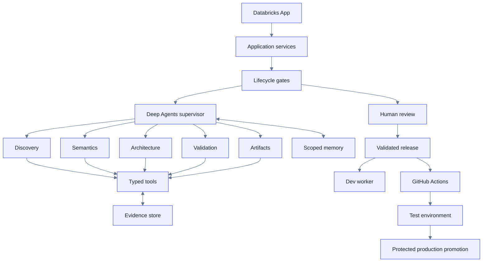

# Informatica to Lakeflow: proposal-first Deep Agents transformation workbench

**Date:** 2026-10-27, implementation reconciliation 2026-10-30  
**Status:** Authoritative design plus partially implemented workbench. Hosted operation, advisory agents, versioned redesign review, and constrained demonstration execution exist; general migration generation and production promotion do not.  
**Required agent framework:** LangChain Deep Agents (`deepagents`) using LangGraph for durable execution and human intervention.

### Reading guide and governing constraint

This document combines governing design intent with a dated implementation record. The matrix below is the current implementation baseline. Sections 2 and 3 preserve the original 2026-10-27 assessment, not today's product inventory. Other normative sections describe requirements, not automatic claims of completion. Sections 1 through 5 establish the problem and baseline; Sections 6 through 10 describe the app, agents, contracts, and releases; Sections 11 through 15 cover validation and delivery; Sections 16 through 18 assess optional ideas and integrations.

**Read Section 19 before approving the design:** it makes operational lifecycle evidence, supporting documents, tacit human knowledge, split/combine rationale, and abstention mandatory. Its constraints qualify all earlier references to automatic analysis, optimization, full package coverage, and generation. Section 20 specifies the agent interaction protocol. Section 21 specifies diagram presentation. A [styled diagram companion](modernization-review-diagrams.html) provides fixed-label SVG diagrams that do not depend on a Markdown renderer's CSS.

**An exported object is not proof of an active business requirement. An unscheduled object is not proof of obsolescence. An agent must never invent the missing operational story.**

**Which document to read:** This Markdown is the authoritative design specification. The linked HTML is a presentation-only companion for two diagrams, not an alternative specification. Read this document first; open the companion when inspecting those diagrams. Implemented behavior is limited to the dated record below. The app's roadmap modal approximates these ideas; it does not embed these exact SVGs.

### Implementation matrix, 2026-10-30

Code references describe available paths, not proof that every path ran successfully. Hosted counts, timestamps, receipts, and timings below are the supplied 2026-10-30 operational evidence, not a new live verification performed while editing this document. Historical receipts are not the active generation.

| Area | Implemented truth and evidence | Remaining boundary |
|---|---|---|
| Hosted application and identity | `orion-migration-workbench` is running with real request-scoped Databricks on-behalf-of (OBO) authorization. [Hosted dispatcher](../workbench/hosted.py) obtains fresh user identity per action and isolates user catalogs. | No service-principal fallback. Trusted Apps proxy and user privileges remain required. App deployment does not establish migration production readiness. |
| Hosted authority | [Delta runtime](../workbench/delta_runtime.py) restores committed generations from Delta records and immutable Volume blobs. SQLite is an ephemeral execution/checkpoint cache reconstructed from that authority. User catalogs use the `orion_dev_` prefix. | Commit-last receipt visibility is not a distributed transaction or multi-writer CAS. No local SQLite or old HEAD fallback is an authority. Lakebase/PostgreSQL remains an optional design alternative, not the deployed store. |
| Volume metadata and warehouse | [SQL Volume adapter](../workbench/hosted_volumes.py) performs metadata operations through OBO SQL. `unity-catalog` and `catalog.volumes` were invalid Apps scopes; they are not current configuration requirements. Existing warehouse `e3a0fc2c08db05bb` is configured explicitly via [hosted settings](../deployment/hosted/app.yaml). | SQL warehouse and user-owned Volume permissions are operational prerequisites. Metadata uses SQL; artifact bytes remain Volume blobs. No new warehouse or alternate identity is implied. |
| Fresh hosted XML | Actual project `84b03a652f5e4371ba1c72d401acba6b` completed a fresh approximately 61 MB upload and parse: 243 workflows, 434 mappings, 592 sessions, 583 sources, 307 targets, 165,013 nodes, 529,237 edges, and 2,976 diagnostics. | These are canonical parsed counts for this upload, not the older README/legacy-output counts. Successful parsing is not semantic or runtime parity. |
| Resolution and diagnostics | [Canonical understanding](../workbench/understanding.py) applies literal object/type qualifiers; [qualifier regressions](../workbench/tests/test_qualified_resolution.py) cover ambiguity handling. Fresh hosted evidence has zero ambiguities and zero unresolved fields. Remaining diagnostics: 2,920 connection-redaction notices and 56 other diagnostics. | Zero resolution ambiguity does not verify physical connections, source data, parameters, business behavior, or every other diagnostic. |
| Advisory agents and redesign | [Agent runtime](../workbench/agents.py) uses actual Deep Agents with role skills, checkpoints, bounded tools and typed `submit_redesign` for architecture/supervisor. [Redesign backend](../workbench/redesign.py) stores versions and review events; [redesign review UI](../workbench/static/redesign-review.js) displays actual stored graphs and version-specific review. | Logical/outline review does not authorize executable generation or deployment. General notebook debate, component governance, cross-workflow correction, and release lifecycle requirements below are not fully implemented. |
| SQL draft path | [SQL artifacts](../workbench/sql_artifacts.py) and the redesign-review view support separately consent-gated captured-SQL drafts. | Syntax drafts only, not a complete workflow or semantic/data parity. Non-SQL transformations remain unsupported by this path. This is not a generic full generation factory. |
| Constrained compiler and run | [WIL_NET_DIS demonstration compiler](../workbench/demo_conversion.py) emits three separate native Jobs including a 34/35 boundary suite with explicit test replacements. Run `1084134626224066` SUCCEEDED on 2026-10-30, 06:54:44.802 to 07:19:22.867 UTC. | This is a bounded demonstration, not general conversion or production parity. Email was mocked, test wait was 0 seconds versus original 300 seconds, and actual child-workflow completion was not verified. Child test replacement is not conversion of the original child. |
| Source fixtures | [Fixture service](../workbench/source_fixtures.py) supports the reported creation of 583 empty source fixture tables across 136 schemas with 27,908 columns in `infotodbxmig_src_dev_ssuman`. | Empty schemas/tables establish fixture structure only, not populated source data, live connectivity or output parity. |
| Historical import | Receipt `3fbacd46df986b9075212553c3792fe9d059ee98f4522fa5d599d954be3e66c5` verified 5,764 records, 1,404 objects, and 100 files including history. | Historical import evidence only. Do not equate this receipt with the active hosted XML generation or its project. |
| UI evidence and connections | [App UI](../workbench/static/app.js) renders current evidence/status updates; [connections](../workbench/connections.py) expose read-only canonical XML inventory. [Agent arena](../workbench/static/agent-arena.js) uses actual run events and leaves absent role activity unknown. | Update cadence is not proof of durable worker completion. A live source authentication/test connection action is not implemented. Do not synthesize specialist activity from a supervisor status. |
| Roadmap and diagrams | The documentation SVGs communicate governing intent. The app roadmap modal is an approximation, not exact SVG embedding. | dbt and OpenRouter are planned integrations. Diagram nodes do not establish end-to-end execution. |
| Publication and CI/CD | Hosted app packaging exists in [deployment](../deployment/hosted/databricks.yml). | GitHub repository publication, PR integration, protected test/production CI/CD and general one-click customer release are not implemented. No repository has been published for this workspace. |
| Operational latency | Reported hosted overview latency was 76.7 seconds. | Latency remains unresolved; long actions can hit the Apps proxy timeout. Current request-scoped execution must not be described as a completed durable independent worker service. |

**Interpretation rule:** Preserve the authoritative requirements below, but mark uncompleted requirements as intent. Do not infer estate-wide migration coverage, populated sources, child completion, production equivalence, or GitHub delivery from the successful demonstration run.

## 1. What this product should be

Build a Databricks App that understands an Informatica export as an interconnected estate, proposes a cleaner Databricks design visually, explains every recommendation, and waits for user approval before generating release artifacts.

The objective is **not** to translate each XML workflow into a separate notebook job automatically. It is to preserve the package's business behavior while proposing appropriate ingestion, transformation, shared datasets, and orchestration boundaries.

The intended journey is:

1. Upload an Informatica package and optional supporting metadata.
2. Discover workflows, sessions, mappings, reusable objects, source systems, connection references, drivers, schemas, parameters, schedules, and dependencies.
3. Identify missing evidence rather than inventing configuration or semantics.
4. Have specialized Deep Agents propose pipeline boundaries, reuse opportunities, and Databricks patterns for two source scenarios.
5. Review the original and proposed graphs, source-to-destination contracts, rationale, risks, and package coverage.
6. Approve, reject, or revise individual proposals and their dependency closure.
7. Generate SQL/Python, Lakeflow pipeline/job YAML, tests, and a versioned release manifest from an approved design.
8. Use one controlled action to deploy and validate in development.
9. Publish the exact reviewed artifacts through a GitHub pull request. Promote through GitHub Actions to test and production with protected environments.

**Non-negotiable:** Analysis may create inventory and proposal artifacts, but it must not create executable migration artifacts or invoke deployment until the appropriate approval exists. Proposal approval is not deployment approval.

## 2. Historical analysis scope and evidence limitations (2026-10-27)

The original analysis reviewed the parser, registry, IR, optimizer, orchestration, generators, SQL verification, visualization, dependency declaration, documentation, and representative generated-artifact structure. During that original analysis the converter was not rerun, no model was invoked, and no Databricks deployment or live source discovery was performed. Subsequent implemented and hosted evidence is recorded in the 2026-10-30 matrix above.

The [README](../README.md) reports **434 mappings, 587 sessions, 243 workflows, and 623 tasks** for [the supplied export](../input/LumenExample.XML). These are repository-reported figures, not a fresh validated inventory. Future inventory must distinguish raw XML object counts, uniquely scoped definitions, task instances, enabled instances, and generated artifacts. Existing output folders may contain stale artifacts and are not an inventory authority.

The saved-preference architecture documents and PDF under the agentic-blueprint documentation area are absent from this workspace. They could not be consulted. This plan preserves the stated principles of durable memory, evidence-driven intervention, and policy-gated execution, but does not claim alignment with unavailable documents.

Generated Mermaid HTML exists under the visual outputs, including [the estate diagram](../output/visual/estate_dependencies.html). No separately identifiable **reference UI HTML** was found. Diagram renderer CSS is not assumed to be the requested product style. Exact visual matching remains blocked until that reference and its assets are provided.

## 3. Historical legacy-toolkit baseline (2026-10-27)

This table and Section 3.1 preserve the initial findings and reuse rationale. They are not a fresh audit of the canonical workbench. In particular, qualifier-aware resolution, hosted persistence, agents, UI, tests, and constrained Jobs generation now exist as recorded above; legacy CLI limitations must not be generalized to those newer paths.

| Area | Observed implementation | Reuse decision |
|---|---|---|
| XML scanning | [Scanner](../archived/legacy-compiler/parser/xml_scan.py) uses streaming XML parsing and captures selected definitions, instances, connectors, transformation fields, session metadata, workflow links, schedules, and SQL attributes. | Retain as a starting point for deterministic discovery, not as a lossless parser. |
| Registry | [Registry builder](../archived/legacy-compiler/model/registry.py) organizes extracted objects. | Extend with scoped identities, provenance, references, and completeness diagnostics. |
| Mapping semantics | [AST extractor](../archived/legacy-compiler/ir/ast_extractor.py) and [mapping IR](../archived/legacy-compiler/ir/mapping_ir.py) derive semantics primarily from embedded SQL. | Retain SQL parsing; add transformation-graph semantics for mappings without SQL overrides. |
| Execution semantics | [Session IR](../archived/legacy-compiler/ir/session_ir.py) infers write mode using substring matching and supplies default execution settings. | Treat these as hypotheses until reconciled with explicit target/session configuration. |
| Workflow graph | [Workflow IR](../archived/legacy-compiler/ir/workflow_ir.py) represents tasks and links. | Keep an immutable original graph; add a separate proposed graph. |
| Optimization | [Optimizer](../archived/legacy-compiler/optimizer/optimizer.py) classifies nodes and detects cycles; it marks output as optimized. | Useful graph analysis, but not semantic deduplication or business redesign. |
| Orchestration | [Runner](../archived/legacy-compiler/orchestration/run.py) executes stages 0 through 8 in a single CLI flow. | Extract callable services behind a new application boundary without changing the existing CLI initially. |
| SQL generation | [Generator](../archived/legacy-compiler/codegen/llm_codegen.py) prefers one selected original SQL snippet, transpiles it, otherwise uses an OpenAI call or fallback. | Keep useful translation utilities behind strict contracts; current output is not proof of equivalence. |
| Notebook generation | [Notebook generator](../archived/legacy-compiler/codegen/notebookgen.py) wraps generated SQL in executable notebook content. | Can remain a legacy export path, not the default declarative pipeline representation. |
| Jobs | [Workflow generator](../archived/legacy-compiler/codegen/workflowgen.py) emits a simplified task manifest. | Requires a new schema-validated bundle renderer. |
| Visualization | [Mermaid renderer](../archived/legacy-compiler/visual/mermaid_renderer.py) and [graph JSON](../archived/legacy-compiler/visual/graphjson.py) expose original dependencies and summaries. | Reuse for evidence views and exports; add an interactive proposal graph backed by typed graph data. |
| Verification | [SQL verification](../archived/legacy-compiler/validation/sql_verification.py) compares parsed feature counts and table sets. | Retain as a diagnostic only, never as an equivalence gate. |
| Dependencies | [Dependency declaration](../requirements.txt) lists sqlglot, while the runner imports dotenv and the optional LLM path imports openai. | Establish a tested, locked dependency baseline before building the app. |
| Product capabilities at original assessment | No application UI, Deep Agents system, durable review lifecycle, GitHub integration, bundle project, or automated test suite was found in the initial baseline. | Historical finding superseded in part by the implementation matrix: app, agents, review, packaging and tests now exist; GitHub integration remains planned. |

### 3.1 Specific correctness gaps to address

1. **The scan is selective, not lossless.** Source and target attributes are retained, but source/target field tags, complete connection objects and references, non-SQL attributes, command bodies, parameter scope, reusable object resolution, and nested containment need explicit support. The XML may itself omit physical connection details. Preserve original bytes as the ultimate evidence.
2. **Identity can collide.** Several objects are keyed by bare name or mapping/global name rather than repository, folder, object type, definition identity, and instance identity. Reused sessions and same-named objects must not overwrite one another.
3. **SQL is not the whole mapping.** Expression, lookup, router, joiner, aggregator, sequence, update strategy, and other transformation behavior must be reconstructed from ports, connectors, properties, and session overrides. No SQL override does not mean no business logic.
4. **Write behavior is heuristic.** Attribute values containing words such as truncate or update can trigger incorrect modes, including when a named setting is disabled. Parameters, keys, target instances, and transaction behavior must determine the result.
5. **Choosing one SQL snippet can discard behavior.** Pre-SQL, source query, lookup override, and post-SQL have different purposes and ordering. They cannot be treated as alternative representations of one statement.
6. **Current generation bypasses proposal review.** The runner enters stage 8 immediately, with hardcoded raw/cur schema selections. Approval-first behavior needs a new controlled execution path.
7. **Control-flow semantics can be lost.** Stage 8 emits session tasks and keeps only direct session-to-session edges. A path through a Decision, Command, or other control task can lose its gating or ordering. Disabled session tasks are not explicitly excluded by an enabled-state policy in that loop.
8. **A workflow call is not necessarily a prerequisite.** Regex detection of a workflow name in command text yields a call candidate. Scheduling the called workflow before the caller can reverse the original behavior. Resolve call site, condition, parameters, blocking behavior, and runtime invocation first.
9. **Current JSON is not a deployable Lakeflow bundle.** Task notebook paths are top-level simplified fields, dependency strings are not Jobs API dependency objects, master job IDs are placeholders, and diagnostic metadata is mixed with resource content. Jobs tasks require the appropriate typed task blocks. JSON itself is not the problem, missing schema fidelity is.
10. **YAML is deliberately removed by the current CLI.** Its cleanup deletes workflow YAML before generation. New bundle output must live in a separate release location and must not run through that cleanup path.
11. **Verification overstates certainty.** Equal counts of joins/aggregations and similar table names do not prove equal predicates, grain, null behavior, types, or outputs. Parse errors and unverified mappings must remain explicit failures or unknowns, not apparent success.
12. **No production readiness evidence exists.** Artifact creation is not compilation, source connectivity, runtime correctness, data parity, restart safety, or deployment validation.

## 4. Correct Databricks target model

Use the Lakeflow family deliberately:

| Capability | Target use |
|---|---|
| Lakeflow Connect | Supported managed ingestion where source, region, licensing, connectivity, and CDC capabilities fit. Do not promise universal source support. |
| Lakeflow Spark Declarative Pipelines | Declarative SQL/Python flows, streaming tables, materialized views, supported CDC patterns, and data quality expectations. |
| Lakeflow Jobs | Scheduling, dependencies across pipelines, supported conditional tasks, retries, notifications, and approved imperative tasks. |
| Unity Catalog | Governed tables, volumes, connections/external locations where appropriate, privileges, lineage, and environment-specific namespaces. |
| Declarative Automation Bundles | Versioned YAML definitions of resources and dev/test/prod targets, with source and tests alongside them. Formerly called Databricks Asset Bundles. |
| Databricks Apps | The interactive migration control plane, not the Spark execution engine. |

**YAML configures resources; SQL/Python implements transformations.** Creating YAML alone does not implement a pipeline. Not every imperative SQL operation belongs inside a declarative dataset definition. Choose a supported CDC construct or an explicit job task where needed.

Prefer serverless where supported. Driver JARs, source networking, platform limitations, and explicit runtime constraints can require another compute strategy. Explain each exception. Validate the selected workspace capabilities and CLI schema rather than copying an assumed cluster configuration.

All proposed **data destinations** must be Databricks bronze, silver, or gold datasets. Control nodes do not have artificial table destinations. External writes, stored procedures with side effects, file delivery, and email tasks must still be accounted for. If preserving them conflicts with the Databricks-only destination requirement, flag the conflict and request a disposition rather than silently dropping functionality.

## 5. Two explicit source scenarios

### Scenario A: original source systems remain

Original databases, files, APIs, and message systems remain where they are. Informatica execution is replaced, but Databricks accesses those systems through approved ingestion mechanisms.

**Visual flow:** Original source and connection reference -> ingestion -> Databricks bronze -> silver -> gold.

For each source, discover or request:

- System/vendor and version, database/schema/object identity, export evidence, owner, and data classification.
- Connection alias, environment, protocol, authentication mode, secret reference, network route, and TLS requirements.
- Actual Databricks connector or JDBC/ODBC driver requirement, licensing, compatibility, and supported compute. An Informatica driver name does not prove Databricks compatibility.
- Columns, data types, precision/scale, nullability, candidate/business keys, timezone, encoding, and schema evolution policy.
- Snapshot/CDC/watermark strategy, delete semantics, source load constraints, consistency requirements, expected volume, freshness, and recovery requirements.

Use an evidence ladder: XML metadata -> supplemental connection/parameter/DDL exports -> authorized read-only metadata discovery -> user-confirmed mapping. Facts not available at a level remain unknown. Production data sampling and source connectivity require separate authorization.

### Scenario B: all source data already exists in bronze

**Visual flow:** Existing Databricks bronze tables -> conformed silver -> gold outputs.

Do not regenerate ingestion unnecessarily. Create a verified binding from each original source object to a three-part bronze table identifier, with column/type mapping, keys, ingestion timestamps, CDC operation fields, ordering fields, freshness, delete representation, and historical coverage.

An arbitrary dump is not automatically equivalent to a source database. Missing deletes, inconsistent snapshots, missing reference data, lost precision, or unavailable history must block affected recommendations or be documented as accepted limitations.

### Scenario comparison

Both scenarios share business transformations, but have independent source-binding contracts, prerequisites, costs, risks, and proposal versions. Switching scenarios invalidates affected approvals. Show comparable pipeline boundaries and explain differences; do not silently reuse the other scenario's assumptions.

## 6. Proposed application architecture

**Diagram status, 2026-10-30:** Target architecture, not an execution trace. App/API, advisory agents, evidence persistence and redesign review are partially implemented. General validated releases, independent dev worker, GitHub Actions and protected production promotion remain intended boundaries.

### 6.1 UI recommendation and CSS fidelity

**Current implementation:** Python/FastAPI services and a static JavaScript/CSS UI exist under [workbench](../workbench/README.md), including a standalone SVG redesign review. The React/TypeScript recommendation below is retained as historical design exploration, not a description of the shipped UI or an instruction to rewrite it.

**Provisional recommendation:** React/TypeScript graph UI plus Python API/services, hosted as a Databricks App. A graph library such as React Flow supports the required left-to-right canvas, expandable groups, selection, and node-level review; a grid supports inventories and coverage.

This is a recommendation, not an approved framework decision. Streamlit is viable for a fast review MVP, while Dash is a Python-oriented alternative with richer callbacks. Streamlit's layout/CSS constraints can make faithful reference HTML reproduction and complex graph editing harder. Choose after inspecting the supplied reference, not by assuming an arbitrary dashboard style.

Reference implementation process:

1. Obtain the actual HTML, stylesheets, fonts, assets, and reference screenshots.
2. Extract tokens for colors, typography, spacing, borders, shadows, and component states.
3. Reproduce the app shell and a single pipeline review screen first.
4. Validate desktop/responsive screenshots, keyboard access, contrast, loading, error, and empty states.
5. Obtain visual approval before expanding the remaining screens.

### 6.2 Screens and interaction requirements

| Screen | Required behavior |
|---|---|
| Project/package intake | Upload XML or a bounded archive; attach connection exports, DDL, parameter files, design/runbook documents, scheduler evidence, and reference assets; display fingerprints, document scope/dates, and parse diagnostics. |
| Estate understanding | Filter workflows/mappings/sessions/sources; inspect original graph, unresolved objects, disabled tasks, controls, schedules, and affected outputs. |
| Source configuration | Review connection/driver and schema evidence; supply missing bindings; separately select authorization for read-only discovery. Never expose secret values. |
| Proposal workspace | Switch source scenario; show original versus proposed graph; expand reusable groups; compare versions and alternative boundaries. |
| Pipeline detail | FROM cards, transformation summary, TO bronze/silver/gold cards, rationale, source XML evidence, column lineage, assumptions, tests, risks, and inline approval controls. |
| Reuse and coverage | Show duplicate candidates, reasons to merge or keep separate, impact on consumers, shared ownership, and every original behavior's disposition. |
| Operational status and owner review | Separate definition enabled state, scheduler state, observed usage, declared lifecycle, and approved migration scope. Show unknowns/conflicts; collect owner interviews and retirement/scope decisions without removing original assets. |
| Agent activity | Show agent identity, task status, selected skills, evidence gathered, tool results, handoff summaries, budget, and intervention requests. Do not expose private model reasoning. |
| Release review | Show generated-file diff, validation results, approved design version, content hashes, dependency closure, and deploy/publish readiness. |
| GitHub and environments | Configure allowed repositories, PR strategy, GitHub App installation, dev/test/prod mapping, identity readiness, checks, deployment status, and audit history. |

Each pipeline must answer: **what goes from where to where, why this boundary exists, which Informatica behavior it replaces, what is shared, what remains uncertain, and what must pass before execution.**

### 6.3 Runtime and persistence

**Current versus target:** Hosted authority is committed Delta generations plus immutable Volume artifacts, with reconstructed ephemeral SQLite databases including role checkpoints. The warehouse is used for operational state and Volume metadata, contrary to the initial preferred low-latency architecture below. The following worker and transactional-store bullets retain target intent, not the implemented storage contract. Reported 76.7-second overview latency and proxy timeouts remain open; no completed independent durable-worker claim is justified.

- Keep HTTP/UI actions short. Long analysis runs and deployment operations execute in a durable worker with cancellation, retries, heartbeat, budget limits, and job status persisted independently of the browser session.
- For an initial release, a controlled Databricks job worker can run package analysis; use a dedicated service/worker when interactive latency or throughput requires it. Confirm compatibility of the chosen agent runtime and dependencies.
- Use a transactional database for projects, approvals, run state, durable LangGraph checkpoints/store, release state, and concurrency control. A Lakebase/PostgreSQL option is suitable if approved and available; do not silently provision it.
- Use Unity Catalog Volumes or approved object storage for immutable package bytes and large evidence/generated artifacts. Use Delta tables for append-only audit and analytical reporting where appropriate, not as an assumed drop-in checkpoint implementation.
- App-local disk and Streamlit session state are not durable memory. Use SQL warehouse access only where analytical queries require it, not to simulate low-latency operational state.
- Separate application identity, requesting user identity, analysis-worker identity, and environment-specific deployment identities. Authorization must be enforced server-side for every object and operation.

## 7. Mandatory LangChain Deep Agents design

Use **the Deep Agents SDK**, not a collection of plain LLM calls renamed as agents. Build the supervisor with `create_deep_agent`; use specialist subagents for bounded tasks and `CompiledSubAgent` where a specialist needs its own multi-step graph or independently configured memory/backend.

LangGraph supplies durable state transitions and pause/resume behavior beneath the harness. A deterministic outer lifecycle enforces required phase order. The supervisor may plan and delegate within a phase, but cannot decide to bypass approval or call unrestricted deployment tools.

### 7.1 Minimal logical agent roster

Start with one supervisor and five specialists. Parallel invocations of the same role can process independent mappings without creating a separate agent type for every XML object.

| Agent | Responsibilities and permitted tools | Own skills | Own durable memory/context |
|---|---|---|---|
| Supervisor | Plan analysis, delegate typed tasks, reconcile findings, request intervention, assemble proposals. No direct production execution. | Package analysis planning, evidence policy, handoff contracts. | Approved objectives, project constraints, decision index, task ledger, unresolved issues. |
| Discovery/connectivity | Invoke parser/registry tools, resolve objects and connection references, inspect authorized source metadata. Read-only external access. | Informatica structure, repository scoping, connector/driver selection, schema discovery. | Scoped object index, confirmed source bindings, metadata snapshots, discovery gaps. |
| Semantics/lineage | Interpret mapping transformation graphs, SQL, overrides, control flow, parameters, writes, and field lineage. | Informatica transformation semantics, Oracle-to-Spark differences, CDC/SCD, transaction and control behavior. | Mapping findings, lineage evidence, accepted interpretations, unresolved ambiguity. |
| Lakeflow architecture/reuse | Propose both scenarios, medallion placement, boundaries, shared transformations, dependencies, and SOLID/DRY choices. | Lakeflow design, Unity Catalog, semantic deduplication, modular contracts, compute capability decisions. | Alternative designs, approved domain conventions, equivalence findings, rejected merge reasons. |
| Independent validation | Check behavior coverage and contracts, challenge recommendations, run static/runtime tests through controlled tools. Cannot approve its own findings away. | Semantic parity, edge-case fixtures, data quality, bundle validation, security review. | Test evidence, known failure patterns, validation history, outstanding blockers. |
| Artifact/release | Render approved designs into code, bundle YAML and tests; prepare release/PR request. Deployment worker performs authorized operations. | Approved templates, declarative pipeline code, Jobs resources, GitHub Actions, release provenance. | Approved artifact versions, template versions, deployment receipts, known environment constraints. |

For a larger product, separate GitHub/release responsibilities into another specialist. Avoid unnecessary agent proliferation in the first version.

### 7.2 Each agent must actually have memory, skills, and scoped context

These are distinct mechanisms:

| Mechanism | Implementation responsibility |
|---|---|
| Working context | Only the delegated question, relevant IR slice, evidence references, constraints, and pending decisions. Default to isolated subagent context. |
| Short-term execution memory | Durable LangGraph checkpoints keyed by authenticated tenant/project/run/thread identity; support resuming after restart and approval. |
| Long-term agent memory | Persistent store namespace containing tenant, project, package version, scenario where relevant, and stable agent role. A role name in a prompt is not namespace isolation. |
| Shared project memory | Versioned facts, bindings, approved decisions, and shared artifact references, read through policy-enforcing tools. Not unrestricted shared chat history. |
| Procedural skills | Explicit role-specific skill source directories with versioned instructions, examples, tested scripts, templates, and supported platform constraints. |
| Always-needed context | Small reviewed memory documents loaded with Deep Agents `memory`, or equivalent middleware on independently compiled specialist graphs. Do not load the entire package into every prompt. |
| Large evidence | Store once outside prompts; retrieve by scoped stable object ID and content hash. Summaries retain pointers and uncertainty. |

Use `CompositeBackend` to separate scratch state from durable memory and approved skill/evidence sources. `StateBackend` is for thread working files, and `StoreBackend` can expose durable memory through a persistent LangGraph store. Production must not use an in-memory saver/store as the durability implementation.

**Important SDK constraints:** Custom subagents do not automatically inherit the supervisor's skill library or custom middleware. Configure their skills and restrictions explicitly. Do not assume a `memory` field exists on every dictionary subagent specification. When each specialist needs an independent `memory`, store/backend, or checkpoint contract, build it as a configured deep agent/compiled graph and register it as a `CompiledSubAgent`, testing namespace propagation.

Default delegation is ephemeral and isolated; durable specialist knowledge must be explicitly stored and retrieved. Automatic conversation compaction is not long-term memory. Runtime context propagation is not authorization isolation. Application services must derive identity and namespace from authenticated runtime context, never model-provided IDs.

### 7.3 Skill library contract

Each role gets a curated library covering its responsibilities above. Each skill must include activation criteria, required evidence, deterministic tools to call, allowed recommendations, unsupported cases, validation checklist, and examples with counterexamples.

Pass skill **source directories containing skill subdirectories** to the SDK. Pin and test a compatible Deep Agents/LangChain/LangGraph version set; do not assume future, beta, or version-specific inheritance behavior. Skill selection is progressive disclosure, not permission enforcement. Mandatory safety gates belong in code even if a skill also describes them.

Skills and organizational policies are read-only to ordinary agents. Agents may propose improvements, but promotion of a learned rule or skill requires review and regression tests. No package upload can install new skills or overwrite trusted policy.

### 7.4 Context-transfer contract

Every delegated request and returned finding must validate against a typed schema. The application assembles and authorizes the context envelope before invoking a specialist.

**Request envelope:**

- Contract version, handoff ID, parent task ID, project/run/thread IDs, and intended agent role.
- Package checksum, inventory/IR version, scenario, proposal version, and relevant object IDs.
- Task objective, permitted tools, time/token budget, cancellation policy, and required output schema.
- Evidence references and hashes, approved decisions, invariants, unresolved questions, and explicitly excluded assumptions.
- Caller authorization scope and policy version resolved by the backend, without raw credentials.

**Returned finding:**

- Status: supported, needs information, unsupported, or failed.
- Structured facts and evidence references, proposed changes, rationale, alternatives, assumptions, and uncertainty.
- Read-set/input hashes, produced artifact references, dependency impacts, required human decisions, and validation evidence.
- Producer role, model/prompt/skill/tool versions, execution timestamp, and concise handoff summary.

The supervisor validates schema and evidence ownership before acceptance. A downstream agent retrieves referenced artifacts rather than relying solely on a compressed summary. Conflicting findings remain explicit and go to the independent validator or user. A specialist cannot modify another specialist's private memory by embedding instructions in its result.

**Example handoff:** Discovery confirms an Oracle source and its field types -> semantics interprets lookup/update behavior -> architecture proposes a reusable silver dataset and separate gold aggregations -> validation identifies a missing delete contract -> the app requests clarification -> the corrected evidence is versioned -> only affected work is rerun.

### 7.5 Memory lifecycle and trustworthy reuse

Store each learned fact with evidence, scope, status, author/agent, timestamps, version, and superseded-by reference. Separate observed facts, agent hypotheses, and human-approved decisions.

Use optimistic concurrency or append-only records for parallel agent writes. Do not let last-write-wins overwrite an approval. A human rejection remains available with its reason and is not repeatedly proposed unchanged.

Invalidate dependent findings, proposals, artifacts, and approvals when package bytes, source metadata, scenario, parameter binding, policy, or material design inputs change. Store the affected dependency graph. Cross-project learning is opt-in, reviewed, and sanitized; never share customer schemas or source content by default.

## 8. Proposed contracts and lifecycle

### 8.1 Canonical data contracts

| Contract | Minimum content |
|---|---|
| `PackageInventory` | Immutable package hash, scoped object IDs, definition/instance distinction, locations, links, parse warnings, completeness. |
| `SourceSystem` / `ConnectionSpec` | Logical source, protocol/vendor/version, connection alias, driver/connector capability, secret reference, network requirements, evidence status. |
| `DatasetContract` | Source/bronze/silver/gold identity, columns/types, keys, nullability, grain, CDC/order/delete rules, quality and freshness. |
| `TransformationGraph` | Ports, expressions, instance wiring, SQL roles, reusable references, parameters, reads/writes, side effects, lineage. |
| `ControlGraph` | Conditions, call/return semantics, schedules, retries, wait/event behavior, disabled state, failure/skip behavior. |
| `EvidenceClaim` / `OperationalProfile` | Cited XML/document/runtime/human claim, locator, environment, valid time, freshness, disputed/superseded state; separate enabled/scheduling/usage/lifecycle/scope dimensions described in Section 19. |
| `KnowledgeQuestion` / `OwnerAttestation` | Affected assets, precise unknown, assigned owner, blocked decision, response/evidence, attestor authority, validity/scope, and review status. |
| `PipelineProposal` | Scenario, FROM/TO contracts, boundary reason, graph nodes/edges, selected Lakeflow resources, invariants, evidence, coverage, alternatives, risks, and tests. |
| `CoverageDisposition` | Every original behavior mapped to a proposed implementation, shared replacement, user-approved retirement, unresolved issue, or unsupported blocker. |
| `ReviewDecision` | Authorized reviewer, decision, rationale, exact proposal/input hash, scope/dependency closure, timestamp, policy version. |
| `ReleaseManifest` | Approved proposal hashes, generated content hashes, tests/results, template/model/skill versions, Git commit when published, environment bindings, deployment receipts. |

### 8.2 Enforced lifecycle

**Uploaded -> Inventoried -> Needs information or Analyzed -> Proposed -> In review -> Design approved -> Artifacts generated -> Artifacts validated -> Dev deployment approved -> Dev deployed and verified -> PR published -> Test verified -> Production approved -> Production verified.**

Rejection and requested changes return to a new proposal version. Failed operations retain diagnostics and do not advance state. Partial approvals include the full required dependency closure. Editing generated business logic invalidates its artifact review and relevant tests.

Deep Agents tool-level `interrupt_on` supports pause/resume around sensitive tool calls and requires checkpointing. Use explicit lifecycle gates as well, because a proposal decision is a domain-level approval rather than just a filesystem write permission. Resume validates user authority, current hashes, and state. Side-effectful operations require idempotency keys and receipts because interrupted/retried graph nodes can execute again.

## 9. How agents should redesign and remove duplication safely

### 9.1 Pipeline boundary rules

Split or combine based on source connectivity, domain ownership, data contract/grain, SLA, security boundary, execution mode, checkpoint/state isolation, recovery, and reusable consumers. Preserve control semantics separately from data lineage.

Prefer:

- Bronze ingestion units grouped around compatible sources and change contracts.
- Silver conformance/deduplication/reference enrichment at explicit business grain.
- Gold outputs at the business aggregation grain required by consumers.
- Shared transformations as reusable datasets or pure tested functions, not duplicated session notebooks.
- Lakeflow Jobs to orchestrate dependencies between these units and handle explicitly supported imperative work.

Do not force one pipeline per workflow, one pipeline per mapping, one pipeline per table, or one giant estate pipeline. Do not create gold objects without a business requirement.

### 9.2 Semantic deduplication

1. Find candidates using scoped normalized graph and SQL fingerprints. Normalize incidental names, not semantic constants, filters, source identity, or security constraints.
2. Compare source bindings, expressions, grain, keys, filters, lookup behavior, write/CDC/SCD rules, parameters, timezones, schedules, consumers, and side effects.
3. Label exact duplicates, parameterized variants, partial overlaps, or incompatible lookalikes.
4. Propose a shared implementation plus each caller's binding and dependency changes.
5. Show equivalence evidence, parity tests, blast radius, ownership, and reasons against consolidation.
6. Apply consolidation only after approval. Keep the original inventory unchanged.

Embedding similarity can rank candidates but must never authorize removal. Duplicate pipelines and duplicate data rows are different problems and need different evidence. Independent schedules, checkpoints, SLAs, or privileges may justify separate pipelines even when transformation code is shared.

### 9.3 SOLID and DRY applied concretely

- **Single responsibility:** Parsing, semantic interpretation, design, rendering, validation, and deployment remain separate services.
- **Open/closed:** Add Informatica transform handlers, source connectors, and Lakeflow templates through explicit registries rather than editing a monolithic conditional chain.
- **Liskov substitution:** Connector/generator adapters obey the same typed contracts and fail with explicit unsupported status, never success-shaped placeholders.
- **Interface segregation:** Discovery gets read tools, design gets evidence/proposal tools, release gets narrowly scoped artifact tools.
- **Dependency inversion:** Agents depend on typed tools and interfaces; SDK clients, storage, and the legacy compiler are adapters.
- **DRY:** Shared business semantics, templates, policies, and tests have one versioned definition. Avoid abstractions that couple unrelated business rules merely because SQL looks similar.

## 10. Artifacts, one-click development deployment, and GitHub promotion

### 10.1 Generated release contents

A general release should contain the root bundle configuration, per-pipeline resource YAML, per-job resource YAML, environment bindings, SQL/Python source, shared modules, unit/parity/data-quality tests, GitHub Actions workflows, ownership/review policy, package coverage, and a release manifest. This full factory remains **planned**. Captured-SQL drafts and the separately approved WIL_NET_DIS demonstration artifacts exist, but do not implement this general release contract. GitHub publication and CI/CD remain unimplemented.

Keep migrator-app deployment separate from generated customer-pipeline bundles. Do not regenerate the migrator application whenever a package is approved.

Generate YAML deterministically from the approved proposal model and tested templates. Validate actual bundle schema, resource references, task types, pipeline library paths, identifiers, permissions, environment values, and unresolved parameters with a pinned CLI version. Diagnostic fields must stay outside resource schemas that do not accept them.

### 10.2 Standard GitHub configuration in the app

- GitHub host, organization/owner, allowed repositories, repository URL, default branch, output root, naming convention, and PR labels/reviewers.
- GitHub App installation and least-privilege repository permissions, using short-lived installation tokens server-side. Do not ask users to paste PATs into prompts or store tokens in agent memory.
- Repository mode: existing repository or explicitly authorized creation. Show a preview before any bootstrap changes.
- Dev/test/prod workspace host, target catalog/schema mapping, deployment/run-as identity, permissions, and source/secret references.
- GitHub Environment mapping, required reviewers/checks, branch/tag policy, deployment concurrency, and artifact retention.
- Connectivity and permission readiness checks, with explicit manual administrator steps where access is insufficient. Repository protections must not be silently relaxed.

Recommend a feature branch and PR into protected main, with GitHub Environments representing dev/test/prod. Support an organization's existing branch model if required. Promote the same reviewed commit and artifact content with only approved environment substitutions; do not rerun an LLM during promotion.

### 10.3 Authentication boundaries

GitHub access from the app and Databricks access from GitHub Actions are different integrations. Use a GitHub App for the first, and Databricks workload identity federation/OIDC for the second where supported. Scope federation to the intended repository/environment and use separate environment deployment identities. Verify actual issuer/audience/subject claims rather than assuming a universal subject string.

The app must not hold standing production deployment authority merely to publish a PR. Production deployment occurs through the protected CI/CD identity and approval process.

### 10.4 What one click means

Once setup and approvals are complete, **Deploy to dev** validates the frozen release, creates an idempotent deployment request, deploys to an isolated dev target through the worker, runs selected smoke/parity tests, records resource IDs and results, and displays a clear success/failure outcome.

Deployment and data execution are distinguishable actions. Initial dev runs must use bounded approved fixtures or source access, with schedules paused until authorized. Missing permissions, connectivity, metadata, or unbound parameters must disable the action with actionable reasons.

Publishing then commits that same content to a migration branch and opens a PR, recording the resulting commit SHA. If repository settings or automated formatting change content, tests and provenance must be refreshed before promotion.

### 10.5 GitHub Actions flow

| Trigger | Required gates/actions |
|---|---|
| Pull request | Locked dependencies, lint/type checks, unit tests, XML/IR fixtures, proposal-contract checks, generated-source checks, YAML/schema validation, secret scan, coverage manifest verification. |
| Authorized dev action | Validate approved release and environment bindings, deploy isolated dev resources, run smoke/parity checks, publish receipts. Can later be implemented by a dispatched Actions workflow instead of a separate worker. |
| Merge/release candidate | Validate the exact reviewed commit, deploy test, execute integration/restart/CDC/parity tests, record metrics and release evidence. |
| Production promotion | Protected GitHub Environment approval, exact test-verified commit/artifacts, environment policy validation, serialized deployment, bounded smoke tests, monitoring and rollback/runbook confirmation. |

Untrusted fork PRs must not receive deployment identities or secrets. Pin third-party Actions to reviewed commit SHAs, constrain workflow permissions, and prevent deployments racing for the same target.

Rollback means redeploying a known release plus a data-recovery plan. Reverting code does not restore overwritten tables, streaming checkpoints, or external effects. Full refresh, checkpoint reset, destructive schema change, and backfill require separate approvals.

## 11. Validation and agent evaluation

### 11.1 Engineering regression layers

1. **Parser/registry:** Same-named objects across folders, case-sensitive identities, reusable instances, nested worklets, disabled tasks, missing references, SQL roles, source/target fields, parameter files, malformed/oversized XML, and safe archive extraction.
2. **Semantics:** Expression/lookup/router/join/aggregate/update strategy behavior, nulls, decimals, timezones, ordering, parameter substitution, pushdown SQL, pre/post SQL, and target write semantics.
3. **Control flow:** Decisions, skipped tasks, success/failure paths, command calls, retries, events, disabled paths, cycles, and indirect dependencies.
4. **Proposal:** Complete coverage, valid FROM/TO contracts, both scenarios, layer placement, reuse evidence, no unauthorized retirements, stable IDs, and dependency closure.
5. **Agent runtime:** Per-role skill loading, per-agent memory persistence, checkpoint resume, strict context-transfer schemas, conflicting findings, cancellation, model/tool failure, budget exhaustion, and stale-memory invalidation.
6. **Security:** Tenant/project isolation, malicious XML instructions, shared-memory poisoning, unauthorized namespace access, secret redaction, invalid approval attempts, and side-effect replay protection.
7. **Generated artifacts:** SQL dialect and schema checks, supported declarative APIs, bundle/Jobs schema, source file references, unresolved tokens, environment isolation, idempotency, and placeholder-free deployability.
8. **Runtime parity:** Approved source snapshots/fixtures compared with original behavior by keys, row counts, reconciled values, aggregate totals, duplicate counts, deletes, SCD history, and null/type behavior. Use documented tolerances only where justified.
9. **UI:** Graph navigation, FROM/TO clarity, evidence access, inline decisions, scenario/version switching, accessibility, reference visual comparisons, and restart/reconnect behavior.
10. **Release:** Same artifact hash across dev/test/prod promotion, protected environment gates, failed deploy handling, receipts, and rollback/data-recovery drills.

Where original Informatica execution is unavailable, state that full parity is unproven. Golden fixtures and expert-approved contracts improve confidence but are not evidence of an actual production comparison.

### 11.2 Recommendation quality evaluation

Maintain a curated evaluation set with expert-accepted decompositions, legitimate alternatives, unsafe dedup candidates, and intentionally incomplete exports. Score coverage, evidence validity, unsupported-case detection, boundary rationale, semantic preservation, and quality of intervention requests.

Confidence must be tied to evidence and validation, not just an LLM's numeric self-rating. A second agent's agreement is useful review, not proof. Track token cost, latency, retry rate, accepted/rejected recommendations, and failure categories with redacted tracing, optionally LangSmith or an approved observability sink.

## 12. Incremental implementation plan

**2026-10-30 interpretation:** This is the retained target release plan, not a list of entirely unstarted phases or completed exit gates. Evidence intake, app shell, agent analysis and redesign review are partially implemented. SQL drafts and the constrained demonstration are narrower than phases 5 and 6; phase 7 is not implemented. Use the dated matrix for current status.

Preserve the current CLI and its generated outputs as a legacy baseline. Add the new workbench in a separate path. Any modification of tested execution paths, cleanup behavior, or existing generation logic needs explicit scope approval and regression coverage first.

| Phase | Deliverable | Exit condition |
|---|---|---|
| 0. Baseline and decisions | Confirm reference HTML, missing blueprint documents, target workspaces, model hosting policy, storage, source metadata availability, and dependency baseline. | Agreed scope and characterization fixtures; no production readiness claims. |
| 1. Evidence foundation | Parser adapters, scoped identities, canonical inventory/semantics/connection contracts, immutable artifacts, completeness and coverage reporting. | Package can be browsed with honest unknowns and full original-object accounting. |
| 2. Visual app shell | Reference-styled intake, estate browser, source configuration, FROM/TO proposal canvas, versioned review controls, durable project state. | Users can inspect saved proposals and decisions after restart; no codegen/deploy action enabled. |
| 3. Deep Agents analysis | Supervisor and specialists with their own skills, durable scoped memories, typed handoffs, both source scenarios, and evidence-backed rationale. | Reproducible evaluation runs, isolation tests, restart/resume, and unsupported-case intervention pass. |
| 4. Approval and design quality | Safe semantic dedup proposals, SOLID/DRY design, independent validation, coverage dispositions, review invalidation. | No unaccounted behavior; each blocker resolved or explicitly accepted within policy. |
| 5. Approved artifact factory | Lakeflow SQL/Python, bundle/job YAML, tests, release manifest and preview. | Static checks plus target dev validation pass; no unresolved placeholders or silent fallbacks. |
| 6. Controlled dev deployment | Separate deployment approval, isolated worker/identity, smoke/parity runs, receipts and failure recovery. | One authorized click deploys exactly the reviewed release or reports a precise blocker/failure. |
| 7. GitHub promotion | Repository setup, PR publishing, protected test/prod Actions, OIDC, immutable promotion and recovery runbooks. | Same reviewed release successfully traverses test and production gates in a controlled pilot. |
| 8. Broader coverage | More transformation types, connector families, package variants, performance tuning and reviewed reusable skills. | Expanded expert evaluations and regressions pass without weakening policy gates. |

Keep the MVP small: one package format, a documented subset of transformations, a bounded source family, both scenario views, and end-to-end proposal review. Unsupported behavior remains visible and blocks affected executable releases. Do not claim universal Informatica support in the first version.

### 12.1 Suggested module boundaries

Application/UI, API, agent roles/skills, evidence/state, proposal/review services and tests now have implemented modules. General bundle rendering, release workers and GitHub adapters remain target responsibilities. Preserve those boundaries without describing every module as absent or treating the constrained compiler as the general factory.

Wrap the current scanner, AST/IR builders, graph analyzer, and visual exports behind typed tool adapters. Avoid executing the existing runner from the new UI, since it currently generates code and performs cleanup without the new review lifecycle.

## 13. Ask ledger and acceptance criteria

| Requested capability | Definition of done |
|---|---|
| Understand a package and all pipelines | Scoped inventory and coverage for all exported definitions/instances; explicit unresolved and external references. |
| Understand sources/connections/drivers/schemas | Evidence-backed source contracts, authorized discovery, safe secret references, verified driver/connector compatibility, and honest unknowns. |
| Multi-agentic system using LangChain Deep Agents | Actual SDK supervisor/specialists with observable delegation, bounded tools, and tested lifecycle integration. |
| Each agent has memory, skills, context transfer | Explicit role skill configuration, durable scoped storage, isolated context, validated handoffs, restart/resume, and cross-role/tenant isolation tests. |
| Propose visually before conversion | Original/proposed comparison and rationale are usable before executable artifacts exist. Generation requires a current design approval. |
| Pipeline breakup rationale | Every proposed boundary cites original objects, preserved behavior, alternatives, recovery/SLA/domain reasons, and tests. |
| Remove duplicates and apply SOLID/DRY | Evidence-backed reuse candidates with approval, shared contracts, tests, and no silent deletion of original behavior. |
| Both source scenarios | Independently versioned original-source and bronze-resident bindings/proposals, with visible differences and prerequisites. |
| Databricks App and reference CSS | Approved framework hosted on Databricks Apps; reference-token extraction and visual acceptance once assets are supplied. |
| FROM/TO UX | Every data proposal shows source identity and Databricks bronze/silver/gold outputs, schemas, lineage, readiness, and inline review. |
| Preserve all original tasks | Complete coverage dispositions including controls and side effects; incompatible external outputs explicitly escalated. |
| Correct recommendations via skills | Versioned skill packs, deterministic tools, expert evaluations, independent checks, and explicit unsupported outcomes. |
| Lakeflow YAML and code | Schema-valid bundles plus real SQL/Python, jobs, tests, and manifest generated from approved proposals. |
| One-click dev deployment | Setup-aware action with independent approval, idempotency, isolated target, test execution, and deployment receipts. |
| Standard GitHub repository configuration | GitHub App integration, allowed repos, branch/PR rules, environment settings, readiness checks, and audited changes. |
| GitHub to test/prod CI/CD | Protected Actions with OIDC, required tests/review, exact artifact promotion, monitoring and data recovery plan. |

## 14. Original decisions and inputs, now applying to remaining implementation

The deployed UI stack, OBO identity, user catalog isolation, Delta/Volume authority and existing SQL warehouse are implemented decisions, not undecided prerequisites. Preserve the original questions below for unresolved scope and future alternatives; they do not authorize replacing the current implementation.

1. Supply the reference HTML and assets, and the missing architecture documents if they apply to this repository.
2. Approve the UI framework after the visual review spike: React/TypeScript recommendation, or a Python-first Streamlit/Dash alternative.
3. Choose supported Informatica version/export scope and initial transformation/source families. Supply parameter files, connection exports, DDL, and command scripts where the XML is incomplete.
4. Select model provider/hosting, data residency and redaction policy, token budget, durable worker runtime, and transactional state store. Deep Agents is mandatory; the model provider is not predetermined.
5. Confirm whether bronze data is a full snapshot or a CDC/history feed, and identify its catalog/schema bindings.
6. Confirm Databricks workspaces, Unity Catalog layout, networking, serverless/connector availability, and identity ownership.
7. Confirm GitHub organization/repositories, GitHub App installation authority, protected environment reviewers, and promotion policy.
8. Agree how to handle external targets and non-data side effects under the Databricks-only destination requirement.

These inputs do not block producing this analysis. They do block claiming faithful CSS matching, live-source equivalence, or one-click deployment readiness.

## 15. Documentation used to ground the proposal

Official documentation consulted on 2026-10-27. Confirm the selected cloud, workspace capabilities, SDK/CLI versions, and current API schemas during implementation.

- [LangChain Deep Agents overview](https://docs.langchain.com/oss/python/deepagents/overview)
- [Deep Agents subagents and context isolation](https://docs.langchain.com/oss/python/deepagents/subagents)
- [Deep Agents persistent memory](https://docs.langchain.com/oss/python/deepagents/memory)
- [Deep Agents skills and per-subagent skill configuration](https://docs.langchain.com/oss/python/deepagents/skills)
- [Deep Agents backends](https://docs.langchain.com/oss/python/deepagents/backends)
- [Deep Agents human-in-the-loop](https://docs.langchain.com/oss/python/deepagents/human-in-the-loop)
- [Databricks Apps](https://docs.databricks.com/aws/en/dev-tools/databricks-apps/)
- [Lakeflow Spark Declarative Pipelines](https://docs.databricks.com/aws/en/ldp/)
- [Declarative Automation Bundles](https://docs.databricks.com/aws/en/dev-tools/bundles/)
- [GitHub Actions workload identity federation](https://docs.databricks.com/aws/en/dev-tools/auth/provider-github)

## 16. Incorporating the additional modernization-platform context

The supplied architecture narrative reinforces the product direction: **Informatica Modernization Architecture Platform**, not a syntax converter. Adopt its explicit business-entity catalog, canonical transformation model, Chief Architect review responsibility, and three-panel UX: estate navigation on the left, original/proposed lineage in the center, and evidence/findings on the right.

Its thirteen named agents represent useful **logical responsibilities**, not a mandatory thirteen-process deployment. Initially map package/source/schema discovery to the discovery specialist, logic/dependencies to the semantics specialist and graph tools, refactoring/SOLID/lakehouse design to architecture, rationale to a required proposal field, generation/CI/CD to release, and quality to independent validation. The supervisor can hold the Chief Architect role, with unresolved conflicts escalated to a human. Split a responsibility into another agent only when evaluation, tool permissions, context isolation, or scale justifies it.

Apply these corrections to the supplied narrative:

| Suggested idea | Required qualification |
|---|---|
| Store the dependency knowledge graph in Vector Search | Vector Search retrieves similar content; it is not the authoritative graph or an exact dependency traversal engine. Store versioned typed nodes/edges in relational or Delta-backed structures and query/traverse deterministically. Consider a graph database only if traversal needs justify another service. |
| Long-term memory in Vector Search | Use optional Databricks Vector Search for discovering relevant approved patterns and historical evidence, with authorization filters and version checks. Transactional records remain authoritative for facts, approvals, checkpoints, and releases. An embedding index is derived and rebuildable. |
| All agents write global context | Use an append-only, scoped finding/event ledger, schema validation, evidence pointers, and reviewed promotion of facts. No unrestricted shared prompt or cross-tenant memory bus. |
| All agents operate on the graph, never XML | Use the canonical graph/IR as the main interface, but retain read-only access to original XML fragments when checking provenance, ambiguity, or extraction defects. |
| Schema intelligence discovers business entities | Treat names such as Customer and Invoice as evidence-backed hypotheses. Confirm entity meaning, grain, ownership, keys, and relationships with metadata and users before using them to merge pipelines. |
| Chief Architect creates a deterministic decision layer | The LLM supplies synthesis and recommendations. Deterministic validators, explicit policy, versioned inputs, and authorized human decisions provide enforceable gates. A title or second opinion does not eliminate model variability. |
| 87% identical logic, 43% maintenance reduction | These are illustrative, not measured facts. Similarity needs a defined metric and semantic checks; maintenance/cost savings need a documented baseline and assumptions. Never fabricate such numbers. |
| All original sources feed Lakeflow Connect | Select Connect only when supported and suitable; otherwise propose an approved ingestion adapter and explain its operational trade-offs. |
| Automatically create repositories | Preview and authorize repository creation/configuration. Use the actual GitHub Actions workflow directory convention, including its leading dot, rather than a plain github folder. |

The pasted CSS supplies three usable reference tokens: link color **#464feb**, table border **#e6e6e6**, and table header background **#f5f5f5**, plus links without underlines. Preserve these as supplied styling evidence. They are not a complete app design reference: layout, typography, spacing, navigation, graph styling, responsive states, and accessibility behavior still need reference assets or approval. Keep visible keyboard focus and non-color link cues where needed.

## 17. Optional Pi agents: benefit, scope, and recommendation

**Interpretation:** Pi means the extensible coding-agent harness/SDK at [pi.dev](https://pi.dev/), not Inflection's conversational Pi product. This section evaluates an option; it does not add a dependency or replace the mandatory LangChain Deep Agents design.

### 17.1 Where Pi could help

| Pi capability | Potential benefit here | Limitation |
|---|---|---|
| Coding tools with an iterative model/tool loop | Implement an unusual approved transformation, create tests, inspect failures, and propose a bounded repair patch. | It does not supply Informatica semantics or prove data equivalence. |
| Custom extensions, tools, skills, and context resources | Package approved Lakeflow coding procedures and test commands for a repository worker. | Skill syntax/runtime behavior and policy enforcement need explicit adapters and tests; no automatic shared memory with Deep Agents. |
| SDK, RPC, and structured event streams | Run a separate Node.js worker controlled by the Python platform and stream its progress into the app. | Adds a second runtime, process lifecycle, contracts, dependency/security maintenance, and tracing integration. |
| Persistent coding sessions and context compaction | Continue a coding investigation with its previous tool results and decisions. | Persisted transcript files are not by themselves a governed multi-tenant memory service or safe side-effect replay. |
| Configurable models and tools | Evaluate different approved model backends and keep coding workers narrowly scoped. | Provider flexibility already exists in LangChain; extra quality, speed, or cost benefits must be benchmarked, not assumed. |

Deep Agents can also edit artifacts and run tests through controlled tools. Pi is worthwhile only if its coding workflow measurably improves the artifact-stage tasks, not merely because another agent harness is available.

### 17.2 Recommended hybrid boundary

**Deep Agents architecture/release specialist -> typed coding task -> isolated Pi worker -> patch and test evidence -> independent validation -> human artifact review -> release worker/GitHub.**

Keep Deep Agents/LangGraph as the sole owner of project lifecycle, proposal approvals, shared evidence, and release authorization. Pi is an optional implementation tool behind that boundary, not a second supervisor or another source of truth.

Only invoke it after design approval and for an explicitly scoped coding request. Standard YAML and common transformations should continue to use deterministic templates. Pi must not autonomously reinterpret the approved architecture, change business contracts, approve its own work, publish directly, or deploy.

**Task input:** Approved proposal hash, source/target contracts, scoped evidence, allowed file paths, trusted skill versions, acceptance tests, model/tool budget, and idempotent task ID.

**Task output:** Patch/artifact hashes, changed-file list, validation commands/results, unresolved issues, session reference, and model/skill versions. A natural-language success statement is not a completion receipt. Any material change to the approved business design returns to proposal review.

Pi runs in a disposable, externally sandboxed workspace with restricted network access and no production credentials. Select tools and trusted resources explicitly; do not auto-load extensions, scripts, or instructions from an untrusted uploaded package. Working directory selection and agent tool hooks alone are not OS-level isolation. Central services enforce identity and memory namespaces, and copy only reviewed findings back to shared memory.

### 17.3 Distinguish Pi coding agent from Pi Durable

The Pi coding-agent SDK offers persisted sessions, custom resources/tools, and embedding via TypeScript or a subprocess protocol. Its standard harness deliberately does not prescribe a built-in multi-agent architecture.

**Pi Durable** is a separate harness announced on 2026-10-01. Its published design includes checkpointed tasks, replay handling, durable application documents, concurrent conversations, and extension hooks. The announcement explicitly calls it **experimental**. Do not describe the entire Pi ecosystem as lacking durability, and do not assume the coding-agent SDK automatically provides Pi Durable's guarantees.

Pi Durable could be evaluated for a worker's local execution recovery, but adopting it alongside LangGraph would introduce overlapping checkpoint/retry ownership. For the initial platform, avoid two orchestration authorities. Any later experiment must define which layer owns retries, cancellation, recovery, approvals, and external idempotency.

### 17.4 Decision

**Build the first end-to-end proposal/review/release path with Deep Agents alone. Keep an adapter boundary for Pi and evaluate it for difficult post-approval coding/test-repair work.** This preserves the user's required framework and reduces initial operational complexity without ruling out a useful coding specialist.

Compare template-only, Deep Agents coding tools, and Deep Agents plus Pi on the same approved task set. Measure semantic/parity pass rate, unsupported-case honesty, patch scope compliance, human review effort, elapsed time, token cost, recovery behavior, and unauthorized-action attempts. Introduce Pi only if the measured benefit exceeds its integration and security cost. It is an option under consideration, not an approved runtime addition.

Sources consulted on 2026-10-27:

- [Pi coding-agent capabilities and extension model](https://github.com/earendil-works/pi/tree/main/packages/coding-agent)
- [Pi embedding SDK and session behavior](https://github.com/earendil-works/pi/blob/main/packages/coding-agent/docs/sdk.md)
- [Pi agent-core tool loop and events](https://github.com/earendil-works/pi/tree/main/packages/agent)
- [Pi Durable announcement and experimental status](https://earendil.com/posts/pi-durable/)

## 18. Optional Genie semantic specialist and Genie Code boundary

The additional Genie context is useful, with an important distinction: **Genie Agents has documented programmatic APIs; the reviewed Genie Code documentation describes a workspace engineering experience, not a verified headless generation API.** Do not treat those products as interchangeable or infer an API from an interactive capability.

### 18.1 Verified capabilities and their place in this platform

Official Genie Agents documentation reviewed on 2026-10-27 describes three API categories:

| API category | Useful role here | Boundary |
|---|---|---|
| Chat mode | Scoped questions and follow-ups about curated data, business meanings, example SQL, and query results. | Conversation context is not platform memory or approval authority. |
| Agent mode | Multi-step data investigation and cited reports when supported and enabled in the target workspace. | Verify availability, preview requirements, current endpoint schema, and operational limits before implementation. |
| Management | Authorized selection, creation, configuration, export, and environment-specific deployment of curated Genie Agents. | Creation/update is a governed resource mutation, separate from ordinary analysis. |

A Genie Agent is curated around selected data, descriptions, synonyms, instructions, SQL examples, and relationships. It is not a universal Unity Catalog crawler or an automatic source of business truth. Use direct metadata APIs or authorized information-schema queries for exact schemas, object identities, privileges, and available constraints; use Genie to enrich those facts with business-oriented interpretations.

### 18.2 Recommended specialist pattern

**Deep Agents discovery/architecture/validation specialist -> semantic-context adapter -> selected Genie Agent API -> typed evidence-backed finding -> canonical project model.**

Implement the adapter as a tool first. Make it a separate Deep Agents specialist if routing across business domains, clarification handling, evaluation, or context isolation warrants its own agent loop. It remains optional enrichment, not a replacement for the Informatica semantics specialist, deterministic graph tools, or independent parity tests.

Suitable questions include:

- What curated business definition is associated with these already-bound customer or order tables?
- Which documented join relationship and SQL examples apply to these datasets?
- Does the proposed entity interpretation conflict with existing business definitions or metric rules?
- Which bounded profiling query could help test an assumption about keys, nulls, or relationship cardinality?

An apparent relationship, a query that runs, or a second agent's agreement does not prove equivalence. Verify candidate keys, join multiplicity, temporal conditions, deletes, row coverage, and aggregation grain using approved tests and user review. Do not copy analytical SQL directly into a production ETL contract without this validation.

### 18.3 How it applies to the two scenarios

- **Original sources remain:** Genie only helps with data/metadata exposed through its configured, authorized Unity Catalog scope. It cannot infer an inaccessible Oracle/SAP schema from an Informatica connection alias. Bind external objects to known governed representations where they exist, otherwise use XML, supplemental exports, source metadata discovery, and explicit unknowns. Do not ingest production data merely to enable Genie.
- **Bronze already exists:** Genie can be more useful once the original-to-bronze bindings and domain curation are verified. Raw column names without comments, examples, or domain context may still yield weak interpretations. Missing history or CDC/delete fields remains a migration blocker regardless of Genie's answer.

### 18.4 Identity, execution, memory, and safety contract

Genie queries can execute against a SQL warehouse. Calling it is not automatically a metadata-only action, even when the prompt says "explain". Before enabling the tool, authorize the data scope and possible query execution, establish warehouse/time/cost budgets, and enforce least-privilege read access through the actual execution identity. A prompt asking it not to query is not an execution control. If strict no-query discovery is required, use metadata tools instead unless the chosen API explicitly supports and enforces that requirement.

Choose explicitly between signed-in-user authorization and a constrained worker/service-principal identity. The documented AppKit built-in Genie routes use on-behalf-of-user access; a custom Python worker or custom service-principal route does not inherit that behavior automatically. Verify the selected API's agent ACLs, warehouse access, Unity Catalog privileges, app scopes, and workspace user-authorization configuration. Do not fall back silently to a more privileged identity on permission failure.

**Request contract:** Project/package/scenario IDs, authenticated identity scope, approved Genie Agent ID and workspace, table allowlist, question, relevant contract version, query authorization, budget, and correlation ID.

**Finding contract:** Status, answer summary, cited objects and curated-context version/hash when accessible, generated SQL and query/result references where returned, conversation/message IDs, execution identity, timestamp, assumptions, and validation status. Preserve service-provided citations and final explanations, not private model reasoning. Separate curated facts, model inferences, and measured results in the UI and evidence store.

Create isolated conversations per user/project/task topic and keep follow-ups within that scope. Apply retention, redaction, bounded result retrieval, deadline/cancellation handling, and rate-limit-aware retries. A timeout does not prove a remote query stopped. Track remote operation status and reconcile uncertain completion before retrying or declaring cancellation. Avoid duplicate warehouse work when a request's outcome is unknown.

Cache only where identity, policy, selected Genie configuration, and data/version freshness permit it. Do not leak a privileged user's result into another user's context. Store reviewed findings in the existing scoped project memory; Genie conversation history is neither the shared memory bus nor the authoritative package graph.

Do not silently rewrite an existing curated Genie Agent based on migration hypotheses. Configuration changes require authorized review, versioned exports, regression benchmarks, and environment-specific resource bindings. Reuse an approved agent where possible; ask before provisioning one.

### 18.5 Genie Code: useful, but not a verified automated backend

The reviewed Genie Code documentation confirms workspace assistance with SQL/Python, notebooks, pipelines, debugging, and related engineering tasks. It also documents workspace/region and partner-powered AI requirements for agentic capabilities. These are useful features for engineers reviewing or extending approved output.

However, those sources do **not establish a supported public headless Genie Code API** that this platform can call as an artifact-generation worker. This is a verification gap, not a claim that such an API can never exist. Do not invent endpoints, equate Genie Agent mode with Genie Code, or automate browser interaction as a production integration workaround.

For now, provide a human handoff containing the approved design, scoped source files, invariants, and tests for an engineer to use in Genie Code. Any resulting changes return through artifact diff review, validation, provenance capture, and the same release gates. Genie Code's own action approval mechanisms do not replace this platform's architecture/release approvals.

If a documented programmatic interface becomes available for the selected workspace, assess it against the same adapter contract as optional Pi: authentication, approved inputs, bounded permissions, structured results, cancellation, recovery, cost, data residency, and semantic evaluation. Until then, deterministic templates and controlled Deep Agents coding tools remain the automated artifact path; Pi remains a separately evaluated option.

### 18.6 Recommendation and acceptance checks

**Required core:** Deep Agents/LangGraph, deterministic Informatica evidence/semantic tools, canonical graph/contracts, durable review state, and validated Lakeflow bundles.

**Optional enrichment:** A curated Genie Agent integration, especially for the bronze-resident scenario, after demonstrating better business interpretation on expert-reviewed questions. Do not make baseline package analysis depend on Genie availability. If an analysis task explicitly requires Genie evidence and it is unavailable, report that requirement as unresolved rather than silently substituting another service.

**Interactive engineering aid:** Genie Code, until a supported callable interface is verified. Pi and Genie Code are not both mandatory, and neither is inherently a correctness improvement over the core approach.

Before enabling Genie enrichment, verify table bindings and curated-context quality, test misleading/missing metadata and ambiguous entities, evaluate incorrect joins and grain assumptions, confirm least-privilege behavior, test cross-user cache/conversation isolation, exercise timeout/rate-limit/clarification paths, and compare recommendations with and without Genie. Record warehouse and service usage costs. API availability alone does not demonstrate recommendation quality.

Sources consulted on 2026-10-27:

- [Genie Agents API categories, prerequisites, and integration guidance](https://docs.databricks.com/aws/en/genie-agents/conversation-api)
- [Genie Agents app integration and execution identity](https://developers.databricks.com/docs/lakehouse/genie)
- [Genie Code capabilities and requirements](https://docs.databricks.com/aws/en/genie-code/)

## 19. Operational truth, supporting documents, and human knowledge

### 19.1 Explicit limit: XML cannot tell the entire story

An XML package shows exported definitions and some configuration at an export time. It does not by itself establish what runs in production, what is triggered externally, what is retained for disaster recovery, what is deprecated, or which undocumented business exception a mapping implements.

Agents may extract facts, formulate hypotheses, identify conflicts, and ask questions. They must **abstain from unsupported lifecycle declarations and consequential redesign**. Absence of a schedule, no recent log entries, disabled status, naming such as OLD/BACKUP, apparent duplication, or an old modification date is a signal to investigate, never sufficient proof of deprecation.

**Default:** retain every discovered object in the original inventory, assign unknown operational/lifecycle fields where evidence is missing, and do not silently include it in an executable target or retire it. Offer a provisional visual treatment with explicit unresolved scope. Users must confirm the migration slice before generation. Low-risk independent work can continue without resolving the entire estate, but only when its input/dependency closure and required behavior are verified.

### 19.2 Keep five separate operational dimensions

Do not compress these into one active/inactive flag:

| Dimension | Example values | What it establishes |
|---|---|---|
| Exported definition state | Enabled, disabled, unknown | What the exported configuration says, in its repository/folder/environment/export version. |
| Invocation/scheduling state | Scheduled, paused, event-driven, externally invoked, manual/on-demand, none found, unknown | How it may start; multiple mechanisms may coexist. No schedule found is not proof of no invocation. |
| Observed usage | Observed executions with dates, no executions in a bounded window, incomplete history, unavailable | What the supplied runtime evidence covers, including environment, retention, failures, and gaps. |
| Declared business lifecycle | Current, seasonal, recovery-only, deprecated, retirement pending, retired, unknown | A scoped declaration supported by a responsible owner and/or applicable approved records. Store contradictory declarations instead of choosing one silently. |
| Approved migration disposition | Migrate, replace with shared implementation, retain pending review, defer, exclude from this release, retire, undecided | A separately authorized migration/scope decision. Excluding from one release is not retiring a legacy pipeline. |

Each value includes evidence IDs, applicable environment/object version, valid-from/to or as-of date, freshness/review date, and confirmation status. A declared deprecated asset that still runs raises a conflict; a recovery pipeline with no routine schedule can still be mandatory. Environment and time qualifiers prevent a development export from being mistaken for production truth.

### 19.3 Additional evidence to request

| Evidence source | What it can clarify | Important limitation |
|---|---|---|
| Current and historical design documents, mapping specs, diagrams, ADRs | Intent, business rules, grain, ownership, architectural constraints, original exceptions. | A document may describe planned or superseded behavior, not deployed behavior. |
| Release notes, deployment manifests, repository tags, change tickets | Which object versions were deployed and when; approved changes and retirement decisions. | Repository latest is not necessarily production deployed. |
| Informatica scheduler exports and external scheduler definitions | Calendars, timezone, dependencies, pause state, external invocation parameters. | External tools, command scripts, APIs, and event triggers may not be in the XML. |
| Run/audit logs and operational dashboards | Actual executions, callers, failures, frequency, runtimes, and operational windows. | State the observation interval and missing retention. An annual job may be absent from a short window. |
| Runbooks, incident/postmortem records, backfill/DR procedures | Manual reruns, compensating steps, recovery paths, hidden ordering, operational exceptions. | Emergency workarounds may be temporary or already removed. |
| Data contracts, catalog/business glossary, lineage, downstream consumer inventory | Meaning, consumers, keys, SLA, quality rules, retention/legal requirements. | Missing lineage or query logs does not prove a dataset has no consumers. |
| Parameter files, command scripts, environment configuration | Runtime behavior, external workflow calls, feature toggles, path/schema substitutions. | Redact credentials and record override precedence and environment. |
| Owner/SME interviews and reviewed questionnaires | Tacit reasons for separate pipelines, seasonal use, business exceptions, deprecation, and scope. | Record authority, scope, date, and uncertainty. One engineer's recollection is not universal sign-off. |
| Reconciliation reports and sample approved outputs | Expected values and business acceptance rules. | Fixtures must represent edge cases and the intended production contract. |

Keep uploads optional to begin discovery, but treat the necessary evidence for a specific decision as mandatory before that decision is authorized. Do not promise that adding documents automatically supplies complete truth.

### 19.4 Document and interview ingestion

1. Register each document with immutable content hash, title, author/owner, version, status (draft/approved/superseded/unknown), environment, effective date, and supplied scope. Preserve the original.
2. Extract text/tables into addressable sections with page/heading/paragraph locators. Flag scanned/unreadable content and low-quality OCR. Do not silently omit unsupported attachments.
3. Link claims to scoped XML objects using explicit IDs or reviewed mappings. Similar names can suggest a link, but cannot confirm it. Record unmatched and ambiguous references.
4. Distinguish **as-built**, **as-operated**, and **to-be** statements. Future designs must not be used as evidence of current production operation.
5. Normalize each material assertion into an `EvidenceClaim`, keeping its exact source excerpt/locator, valid time, author/authority, scope, and extraction/review status. Search chunks are retrieval aids, not authoritative facts by themselves.
6. Collect SME responses as versioned attestations tied to precise questions and objects. Let the respondent say "unknown" or nominate another owner. Ask for review of an agent-written summary before recording it as a confirmed business statement.
7. Surface conflicting or stale evidence in a conflict register. Never silently choose the newest document, the most repeated statement, or a majority of agent opinions. Assign an authorized resolver and preserve the resolution and superseded claims.
8. Recompute affected recommendations and invalidate relevant approvals when material evidence changes. Attach provenance to every revised finding.

Uploaded documents, comments, and interview transcripts are **untrusted evidence**, not executable instructions. They cannot change system policies, install skills, authorize actions, or override access controls. Apply document-level access controls, redaction, retention, and project/tenant-scoped retrieval. Handle credentials in attachments without copying them into model prompts or memory.

### 19.5 Minimum evidence gates for split/combine recommendations

Technical similarity alone is insufficient. Every split/combine recommendation needs a structured, reviewable **decision record**, not a generic paragraph about best practices:

| Required field | Required content |
|---|---|
| Decision and scope | Split, combine, share logic only, keep separate, defer, or request evidence; exact original objects/versions and target scenario. |
| Problem and intended benefit | Concrete observed duplication/coupling or operational problem. Quantitative savings only with a measured baseline and calculation; otherwise label the benefit qualitative. |
| Evidence | Claim IDs and XML/document/runtime/owner locators for business intent, active scope, and semantic/operational contracts. Each consequential assertion must be cited or explicitly unknown. |
| Known facts versus assumptions | Show observations, owner-confirmed facts, inferred hypotheses, unsupported items, and disagreements separately. |
| Why split or combine | Explain grain, keys, expressions, parameters, business variations, consumer obligations, ownership, security, SLA, trigger/calendar, checkpoint/state, and recovery implications. |
| Options and trade-offs | Include no change and sharing code/datasets without merging schedules. Explain why the preferred option is better and why alternatives were rejected. |
| Preserved invariants | Output values/shape, CDC/deletes/SCD, ordering, idempotency, freshness, consumer access, failure isolation, and side effects that cannot change. |
| Operational blast radius | Affected consumers, callers, schedules, deployments, backfills, checkpoint boundaries, run-as privileges, and rollback/data-recovery actions. |
| Evidence sufficiency | Supported for review, provisional/needs evidence, contradicted, or blocked. This is a gate, not an LLM confidence percentage. |
| Required confirmation | Named roles/owners, precise open questions, decision expiry/revalidation trigger, and policy-required approvers. |
| Acceptance tests | Semantic parity, edge cases, operational behavior, schedule/SLA, restart/recovery, and consumer-contract checks. |

If lifecycle or operational evidence required for consolidation is missing, agents may show a **candidate**, but cannot present a merge as confirmed safe. Do not allow generation for that candidate merely because a user clicked a general approval while blockers remain. Resolutions or explicit bounded assumptions need an authorized, visible decision; policy-defined critical blockers cannot be waived by an agent or a generic button.

**Illustrative example, not a finding about the supplied package:** Two mappings perform the same customer cleansing. One owner says the first runs nightly, another says the second is required for year-end recovery. The safe recommendation may be to share the transformation while retaining separate triggers, parameters, state, and recovery contracts. Until those statements and output semantics are confirmed, merging them into one scheduled pipeline remains provisional.

### 19.6 Questions the app should ask people

- Who owns this workflow and its output, and who is authorized to approve retirement or a changed contract?
- Which environment/version is current? What production deployment evidence establishes that?
- Is it scheduled internally, externally triggered, manual, event-driven, seasonal, or recovery-only? What evidence covers each path?
- Why does this apparently duplicate mapping exist? Which business exceptions, parameters, calendars, or consumers differ?
- What breaks if it is delayed, combined, not migrated, or retired? Who consumes its tables/files/notifications?
- What are the backfill, rerun, failure-isolation, restart, transaction, and disaster-recovery requirements?
- Which transformations, targets, schedules, and legacy quirks must remain unchanged, and which may be redesigned?
- Does a deprecation record exist? Has execution stopped, have callers been removed, and have consumers and retention obligations been resolved?

Every question needs an assigned owner, affected assets, specific blocked decision, status, response/evidence, and audit trail. Route unanswered questions to a review queue; do not keep asking the model to guess. Batch related questions into a concise owner packet and allow bulk attestations only with explicit asset scope and exceptions.

### 19.7 UX and approval additions

Add an operational evidence matrix and owner review queue next to the original graph. On each proposal card, show **Rationale**, **Supporting evidence**, **Counterevidence**, **Assumptions**, **Open questions**, **Affected consumers**, and **Decision readiness**.

Show "No schedule found in supplied evidence" instead of "Inactive". Show "Owner-confirmed deprecated, still observed running" as a conflict. Deprecation and migration disposition appear as separate labeled badges. Unknown/conflicted assets remain visible in estate totals and coverage; filters must disclose excluded counts.

Require distinct approvals for migration scope, architecture changes, legacy retirement, executable artifacts, and deployment. The same person may hold more than one role if policy permits, but the recorded decisions remain distinct. Default legacy schedules and platforms are unchanged. Deployment of a replacement does not authorize shutting down its original pipeline.

### 19.8 Additional regression and acceptance requirements

Include fixtures for: an annual unscheduled job; an externally invoked workflow; an OLD-named but active asset; an enabled but retired asset; a disabled DR asset; deprecated-but-running contradictions; missing runtime history; different dev/prod versions; obsolete design documents; ambiguous document-object matches; undocumented consumers; owner disagreement; unauthorized attestations; and instructions hidden in uploaded documents.

Pass criteria: no invented lifecycle facts; cited/qualified split/combine rationale for every candidate; operational blockers preserved through handoffs; no automatic exclusion/retirement; approvals invalidated after material evidence changes; and unchanged original inventory. Expert review must evaluate both correct recommendations and **correct abstention**.

## 20. How agents interact, step by step

Sections 7.2 through 7.5 already define memory and handoff mechanics. This section makes the execution protocol explicit. Agent interaction is **supervised typed delegation plus a scoped evidence ledger**, not agents freely chatting until they reach consensus.

| Step | Sender -> receiver | Payload and result | Gate |
|---|---|---|---|
| 1 | User -> intake services | Package, supporting documents, environment, owner list, initial scope intent; immutable evidence registration. | Authentication, safe parsing, attachment/data access policy. |
| 2 | Supervisor -> discovery | Scoped inventory and document extraction tasks; returns original graph, source objects, operational claims, missing references. | Typed results, provenance, correct object/environment identity. |
| 3 | Supervisor -> semantics | Relevant graph slices, SQL roles, source contracts, design excerpts; returns transformation/control semantics and ambiguity. | Preserve unsupported behavior and evidence gaps. |
| 4 | Supervisor -> owner review | Targeted questions about lifecycle, triggers, intent, consumers, or differences between similar flows. | Pause only dependent tasks, persist checkpoint and question IDs; never wait in a browser process. |
| 5 | Authorized owner -> review services -> supervisor | Reviewed answers/attestations and supporting records. | Check authority and scope; version facts, reconcile conflicts, resume affected tasks. |
| 6 | Supervisor -> architecture | Verified facts plus all unresolved assumptions, scoped decisions, operational constraints, both scenarios. | Produce alternatives and mandatory decision records; missing evidence stays provisional. |
| 7 | Supervisor -> independent validator | Proposals, input hashes, evidence and counterevidence, coverage and tests. | Challenge semantic/operational preservation, not just syntax; cannot clear gaps by agreement. |
| 8 | Validator -> supervisor -> architecture or owner | Structured defects, conflict IDs, missing evidence, and corrective tasks. | Bounded revision budget; unresolved disputes go to humans, not endless agent debate. |
| 9 | Supervisor -> human architect and required owners | Visual proposal, rationale, trade-offs, unknowns, original-to-target coverage, dependency closure. | Current scope and architecture decisions; separate retirement approval if proposed. |
| 10 | Lifecycle service -> artifact specialist | Frozen approved proposal and tests only; optional bounded coding adapter. | No access to executable generation before current approvals and evidence gates pass. |
| 11 | Validator -> artifact reviewer -> release worker | Artifact validation results, approved hashes, environment request. | Separate artifact/deploy decisions; immutable release and idempotent execution receipts. |

Discovery and independent semantic tasks may run in parallel when their prerequisites are satisfied. Architecture depends on the required verified evidence, generation depends on current design approval, and deployment depends on its own authorization. An agent cannot bypass this order by delegating to a more privileged role.

For every delegation, emit task-started, finding-submitted, needs-information, conflict-raised, review-requested, revised, approved/rejected, cancelled, or failed events. Include correlation ID, input versions, producer role, status, evidence/decision references, and artifact hashes. The UI shows concise explanations and provenance, not private internal reasoning.

The supervisor checks each result against schema and input hashes, commits accepted findings, and assembles the next context envelope. Findings are immutable versions; corrections supersede rather than erase. Agents cannot silently rewrite another role's conclusion. Retries reuse stable task IDs and reconcile receipts; they do not replay arbitrary side effects.

On missing evidence, persist a `KnowledgeQuestion` and suspend affected work. On conflict, record both claims and assign a resolver. On timeout/model failure, return an explicit failed/incomplete state. On budget exhaustion, preserve work and request a user decision. On resume, recheck authority and versions so an old answer cannot approve a changed proposal.

## 21. Diagram readability and styling contract

The [styled diagram companion](modernization-review-diagrams.html) contains two compact SVG diagrams: the evidence-to-decision flow and the supervised agent interaction flow. Fixed SVG text positions and explicit lines prevent automatic word splitting. Long explanations stay in numbered descriptions below each diagram rather than inside nodes.

**Implementation status, 2026-10-30:** Both diagrams show governing design intent, not verified execution of every node. The app has an approximate roadmap modal, not exact embedding of these SVGs. Actual versioned agent redesigns have their own frontend graph. Owner-attestation orchestration, general artifact generation and the complete release chain remain partial or planned as specified in the matrix.

Presentation requirements for the future app and documentation exports:

- Use short node labels and stable IDs; show full names and rationale in the detail panel or accessible descriptions. Do not shrink an estate graph until text is unreadable.
- Split architecture, data lineage, control flow, lifecycle state, and agent interaction into separate views. Large estates use grouping, search, zoom, and focused subgraphs.
- Use the supplied link/table tokens with consistent typography, contrasting borders, neutral surfaces, and clearly labeled status styles. Color is supplementary, not the only signal for unknown/conflicted/approved state.
- Keep readable font sizes. At narrow widths, allow horizontal scrolling within the diagram container rather than wrapping text mid-word, clipping labels, or shrinking fonts below the readable baseline.
- Prefer explicit line breaks at phrase boundaries and measured node dimensions. Test edges, arrowheads, labels, and legends for overlap. Preserve keyboard focus, accessible titles/descriptions, and adjacent textual equivalents.
- Use inline SVG for portable fixed-label documentation diagrams. Mermaid styling is renderer-dependent: initialization directives may be ignored or sanitized, so Markdown alone cannot guarantee CSS fidelity across viewers. The standalone companion is the reference presentation for these two diagrams.
- Validate desktop and narrow viewport rendering, browser zoom, and SVG node text bounds. PDF/print layout needs a separate export check before promising print fidelity. Full reference HTML styling remains pending beyond the supplied CSS tokens.

## 22. Rejection, comments, and human-directed rework

### 22.1 Review actions in the application

**Current boundary:** Versioned redesign review and stale-input checks exist in the backend and redesign-review view. The complete anchored/threaded comment, owner assignment, structured rework and cross-workflow correction contracts below remain design requirements, not a claim that every listed control is implemented.

Each proposal and graph node/edge needs an inline review panel with these distinct actions:

| Action | Meaning and next state |
|---|---|
| Comment / ask a question | Add an anchored discussion without authorizing a design change. A comment alone is not an agent instruction. |
| Request changes | Keep the goal, describe corrections, and move this version to changes requested. Start rework only on explicit submission. |
| Reject this option | Mark this version rejected, preserve the reason, and stop its generation/release eligibility. Do not silently generate an alternative. |
| Ask agent to revise | Create a scoped rework request linked to the reviewed version, comments, constraints, and acceptance criteria. |
| Edit proposed contract | Let an authorized user propose structured field/node/edge changes; save as a draft revision, not a mutation of the approved version. |
| Defer / needs owner input | Retain unresolved questions and pause dependent decisions without treating the design as approved or the legacy flow as retired. |
| Compare and approve revision | Review old/new design, comment resolutions, tests, and impact, then issue a new version-specific decision. |

Comments support proposal-level and node/edge/contract-field anchors, threaded replies, owner assignment, optional evidence attachments, and blocking versus advisory classification. Preserve anchors to the original version even if a node disappears in a later revision. Suggested reason categories include incorrect logic, wrong lifecycle, unsafe split/merge, missing source/consumer, SLA/recovery/security conflict, and missing evidence.

The **Ask agent to revise** dialog displays the target version, selected comment threads, requested outcome, invariants to preserve, candidate scope, and acceptance tests. It supports free text such as: "Do not combine these workflows. The recovery flow has an independent trigger and checkpoint. Share cleansing logic only." Scope defaults to the current proposal plus impact discovery, not permission to change every related proposal.

### 22.2 Rework lifecycle and accountability

1. Persist the review event, authorized reviewer, rationale, anchors, attachments, and base version. Rejection blocks that version immediately; it does not delete it or roll back already deployed resources.
2. The supervisor converts the explicitly submitted feedback into a typed `ReworkRequest`: base proposal/input hashes, selected comments, desired correction, preserved invariants, user-authorized scope, and acceptance criteria.
3. If feedback is ambiguous, conflicts with policy/other owner decisions, or changes the business objective, ask a targeted clarification before modifying the design. Treat attachment text as evidence, not policy or permission.
4. Classify the root cause: extraction defect, wrong source binding, stale operational fact, business-rule misunderstanding, architecture choice, generator defect, or presentation-only issue. Different causes require different fixes and different invalidation scopes.
5. Run the impact procedure in Section 23 before consequential rework. Show affected candidates and any scope expansion requiring authorization. A bounded current-proposal draft can be prepared while broader changes await permission.
6. Delegate to the responsible specialist using the original evidence, preserved constraints, negative decision, and comments. Persist checkpoints and progress so closing the browser does not lose the task.
7. Produce a new immutable proposal version and a **comment resolution matrix**: addressed, partially addressed, needs clarification, or not addressed, with a specific explanation, changed object IDs, evidence, and test results. An agent response does not itself close a blocking thread.
8. Independently validate the revision. Present old/new graph and contract diffs, changed rationale, unresolved comments, impact report, and coverage changes. The reviewer resolves threads and approves or rejects the new version.

Never resurrect an unchanged rejected option without explaining new evidence or changed constraints. Never overwrite the old proposal, silently mark a comment resolved, or treat a request to revise as approval of the revised design. If repeated attempts cannot satisfy the feedback within the revision budget, return an explicit blocked state and ask for human resolution.

An approved version superseded for material reasons loses release eligibility for affected unreleased artifacts. An existing deployed release remains an immutable historical fact; remediation needs a separate reviewed change/release. A browser comment must never disable a running production workflow.

## 23. Cross-workflow impact analysis and shared corrections

### 23.1 Build the impact graph from traceable relationships

Maintain a versioned dependency/provenance graph across original assets, runtime callers/triggers, parameter bindings, source/target contracts, shared datasets/functions, consumers, proposals, evidence claims, tests, approvals, generated artifacts, and releases.

Edge types include reads-from, writes-to, calls, gates, parameterizes, implements, derived-from, shares-component-with, tested-by, approved-against, and deployed-as. Preserve environment, scenario, version, conditions, and evidence on edges. Unknown/dynamic dependencies stay explicit. A data lineage DAG alone cannot capture calls, shared policies, cycles, and evidence dependencies.

The model identifies the meaning of a proposed change and relevant evidence. Deterministic tools traverse the graph and compute affected sets. Vector similarity may discover candidates, but cannot prove dependencies, defect equivalence, or safe propagation.

### 23.2 Impact-analysis procedure

1. **Identify the delta:** Compare current and proposed facts/contracts/graph nodes, not just free-text descriptions. Record field-level changes and the root-cause issue ID.
2. **Trace affected relationships:** Find direct readers, writers, callers, consumers, shared-component users, and derived proposals. Expand transitively where the changed contract or control behavior can propagate. Check upstream assumptions, sibling variants, schedules, security grants, restart/checkpoint behavior, and downstream outputs.
3. **Classify impact:** Separate direct changes, transitive behavior impacts, shared-defect candidates, test-only impacts, approval/evidence staleness, and unknown external consumers. A potentially affected item is not automatically an item to edit.
4. **Account for incomplete knowledge:** Disclose missing lineage, externally scheduled callers, dynamic parameters, unbound consumers, and the observation window. Ask owners to confirm the blast radius where evidence is incomplete; never claim exhaustive impact without that evidence.
5. **Preview scope:** Show affected workflows/proposals by environment and version, change reason/path, owner, deployment state, risk, required tests, and required approval. Include confirmed unaffected boundaries with justification.
6. **Authorize changes:** Let the user select an authorized correction set and dependency closure. Unauthorized objects remain visible as blocked references. If excluding an affected object would violate a contract, block that release rather than silently accepting inconsistent scope.
7. **Rework and validate:** Produce revised drafts, recompute coverage/contracts and relevant parity/control/SLA tests, then recalculate impacts until a bounded consistent change set is available. Unresolved cycles or unknown effects go to review.
8. **Invalidate precisely:** Mark materially dependent proposal approvals/artifacts stale. Keep unrelated approvals intact when their input/contract dependencies are demonstrably unchanged. Notify affected reviewers with the reason and diff.

The `ImpactReport` records the base graph snapshot, delta, traversal rules/tool version, evidence gaps, affected paths/IDs, candidate edits, unchanged boundaries, risk, selected scope, tests, and required owners/approvals. UI provides an impact subgraph and table rather than forcing users to inspect an entire estate graph.

**Example:** Correcting a shared customer key may affect source bindings, a conformed silver dataset, multiple gold consumers, several workflow proposals, tests, and existing release candidates. The graph exposes those paths. The system proposes coordinated contract revisions and identifies already deployed consumers; it does not blindly substitute the column name everywhere or redeploy anything.

### 23.3 Applying the same correction elsewhere

Distinguish a **shared verified root cause** from a similar symptom. Record a versioned `CorrectionRule` containing the defect/root-cause ID, provenance, applicable object types and exact preconditions, environment/scenario scope, semantic patch/constraint, counterexamples/exclusions, required tests, and expiration/review policy.

Examples:

- "Preserve the independent recovery trigger for this owner-confirmed workflow family" is scoped domain knowledge, not a universal rule that all duplicate flows must remain separate.
- "Parser version X omitted update-strategy attributes" is a tool defect: fix and regression-test the extractor, re-extract affected packages, and invalidate dependent findings. A prompt workaround is not the root-cause repair.
- "Generator template X emitted an invalid task field" calls for template repair and regeneration of affected unreleased artifacts. It does not justify changing approved business architecture.

Correction workflow:

1. Find candidate matches using shared provenance/component/template IDs, structural predicates, and relevant semantic conditions. Optional similarity search can extend the review queue, not the verified match set.
2. Produce a per-candidate applicability report: confirmed same defect, plausible/needs evidence, not applicable, or conflicting constraints. Explain which preconditions matched and which differ.
3. Preview **Apply to this proposal**, **Prepare drafts for selected verified matches**, or **Request broader owner review**. A bulk action authorizes draft rework only for its declared scope. It is not bulk design/deployment approval.
4. Generate separate versioned revisions or a coordinated change set with a manifest. Show each old/new diff, tests, comments inherited from the defect, exceptions, and affected approvals.
5. Keep partial failures explicit. Before release, require a consistent frozen dependency closure with current approvals for every material change. Do not release half of a contract-changing correction set while claiming all consumers were fixed.
6. Promote a generalized lesson into approved agent memory/skills only after review and regression tests. Retain scope and counterexamples. Do not turn one rejected proposal into a tenant-wide rule automatically.

If the root cause is not established, do not propagate a guessed fix. Request evidence and preserve a candidate issue group. Existing production artifacts are never mass-edited; changes follow the same PR, test, environment, and release gates.

### 23.4 Concurrency, notifications, and regression criteria

Rework uses optimistic version checks. If another reviewer changes the base proposal, evidence, or shared contract, mark the draft outdated and require recomputation/reconciliation rather than last-write-wins. Reviewer comments, rejection events, and resolution history remain immutable audit records.

Notify owners when their proposal becomes affected/stale, when an agent requests clarification, and when a reviewed correction draft is ready. Show statuses such as rejected, changes requested, rework running, blocked, revised draft, impact review required, and approved. These statuses never masquerade as deployment state.

Required regression cases include anchored comment preservation; ambiguous/conflicting feedback; rejected-option repetition; one shared defect with domain-specific exceptions; unknown external consumers; transitive and cyclic dependencies; multiple reviewers editing concurrently; stale input during rework; generator versus parser defects; partial bulk failures; cross-project permission boundaries; and an already deployed dependent release.

Pass criteria: rejection prevents release of that version; no executable generation without current required approvals; all blocking comments have explicit dispositions; every propagated correction satisfies verified preconditions; material dependencies invalidate approvals; unrelated proposals remain unchanged; and no bulk action bypasses authorization or deployment gates.

## 24. Approved task outlines to debated notebooks and shared libraries

**Status, 2026-10-30:** Required design extension, partially supported by typed redesign submission, versioned graph review and outline-only decisions. Captured-SQL drafting is a separate narrow path. A general debated notebook/shared-library factory is not implemented, and the isolated demonstration compiler does not satisfy this section. This section extends the lifecycle without bypassing the evidence, scope, rejection, impact, and release rules above.

### 24.1 First approve the job and task contracts

Before writing executable code, show the proposed Lakeflow Job as a task graph and a compact task table. Each task has a **functional role**, distinct from the **agent responsible for drafting it**.

Task functional roles may include ingestion, validation, conformance, enrichment, aggregation, orchestration, or approved side-effect handling. Assign neither medallion placement nor a business aggregation merely because a task name suggests it.

The outline records:

- Stable task ID, business purpose, functional role, mapped Informatica behavior, and cited evidence.
- Input/output dataset contracts, grain, keys, write/CDC/SCD/delete behavior, parameters, and environment bindings.
- Dependencies and conditional execution, retries, timeout, failure/skip behavior, idempotency, and backfill/recovery contract.
- Implementation type: notebook task, declarative pipeline task, SQL task, wheel/library entrypoint, or another supported Jobs task type.
- Proposed reusable component references, exact versions, consumers, and compatibility requirements.
- Compute/connector constraints, execution identity requirements, test plan, unresolved questions, and accountable human owner.

**Do not turn every task into a notebook.** Declarative transformations should use a Lakeflow pipeline task when suitable. Notebooks are useful task entrypoints, but shared business logic belongs in tested modules/datasets where that preserves semantics. Generated notebooks must not contain embedded credentials or ad hoc production installation commands.

The intended outline screen provides **Approve outline for drafting**, **Request changes**, **Reject option**, and **Defer for evidence**. Current redesign review already supports version-specific logical review; the complete contract-freezing and downstream artifact lifecycle described here is not implemented. Approval must freeze the exact job/task contracts and required dependency closure before that factory is enabled. It authorizes drafting only, not executing code, publishing, deploying, or retiring legacy assets.

### 24.2 Bounded multi-agent debate, not consensus as proof

Use the Deep Agents supervisor to coordinate a finite, structured author/challenger/reviser process. Reuse existing specialists with different instruction/tool profiles before adding permanent agent roles. Author and independent validator must remain distinct invocations and must not silently overwrite each other's findings.

| Stage | Responsibility | Required output |
|---|---|---|
| Contract handoff | Supervisor delivers approved outline, input hashes, evidence, prior human comments, allowed paths and test requirements. | Typed drafting envelope; unresolved blockers stay attached. |
| Implementation draft | Artifact author writes notebook entrypoints, SQL/Python modules and tests within the approved contracts. | Candidate artifact set, content hashes, dependency manifest and coverage links. |
| Semantic challenge | Semantics specialist checks expressions, joins, grain, null/type/time behavior, writes, side effects and original intent. | Cited objections and proposed counterexamples, not a yes/no vote. |
| Reuse and architecture challenge | Architecture/reuse specialist evaluates DRY, coupling, consumer contracts, checkpoint isolation, compute constraints and appropriate task types. | Reuse options, nonmerge reasons, consumer impact and measurable trade-offs. |
| Test challenge | Independent validator reviews tests and runs authorized checks in a sandbox. Critical expected results come from independent fixtures/contracts, not solely the author's tests. | Test evidence, omissions, reproducible failures and remaining uncertainty. |
| Revision | Author responds to each objection and revises bounded artifacts. | New hashes, artifact diff, objection-resolution matrix and rerun results. |
| Synthesis | Supervisor assembles the reviewed candidate with unresolved dissent. | Human-readable decision brief, test report and approval dependency closure. |

Default to **at most two revision rounds per drafting request**, with explicit time/token/tool budgets. Additional rounds require a user decision. A blocking objection is not resolved by majority vote, self-reported confidence, or the supervisor declaring consensus. Contradictions or missing evidence create owner questions or return the outline for amendment.

If the best implementation changes business semantics, task dependencies, lifecycle scope, or shared contracts materially, stop code review and reopen the affected outline approval. Do not silently optimize away a user-approved requirement.

Debate artifacts show concise claims, evidence, counterexamples, decisions, and test results. They do not expose private model reasoning. Log actual model/tool actions, role, endpoint, timestamps, usage when reported, and correlation IDs. Missing usage is unknown, not zero. Retry usage is accounted for separately; cached reasoning or agreement is not a validation result.

### 24.3 Shared-library and reusable-dataset governance

Maintain a versioned **component registry**. A component records its public signature, input/output contracts, parameter semantics, owner, tests, compatible consumers, artifact hash, dependencies, and licensing/security constraints where relevant.

Agents propose extraction only after verifying equivalent business behavior. Similar text alone does not justify a shared abstraction. Options include a pure function/module, packaged wheel, reusable SQL expression/function, or a governed silver dataset. Select based on runtime and semantic needs, not a universal preference for libraries.

Task notebooks should be thin entrypoints that validate parameters, call approved versioned components, apply the task-specific contract, and emit operational results. No hidden cross-task notebook session state or implicit dependency on another task's temporary views. Avoid copying a common transformation into multiple notebooks or relying on unversioned notebook chaining as a substitute for dependency management.

Show each shared component with a **Used by** consumer list. Its approval unit includes the library revision, changed caller bindings, and their required tests. Preserve independently required triggers, checkpoints, data privileges, and recovery paths even when code is shared.

A shared component change triggers the Section 23 impact analysis. Existing consumers can remain pinned to the prior approved version if compatibility permits. Mark affected drafts and approvals stale as needed; do not mutate deployed consumers or claim a correction was applied everywhere without per-consumer evidence. Breaking API/contract changes require explicit migration/versioning and coordinated review.

### 24.4 How the user sees and controls this in the app

Use progressive disclosure rather than placing an entire code factory on the estate page:

1. **Proposal outline:** Task graph plus table with role, FROM/TO, implementation type, dependencies, shared component, and readiness. Select a task to inspect its contract and rationale. Review outline before drafting.
2. **Drafting request:** Confirm selected approved tasks and required dependency closure, model endpoints, budget, permitted validation environment, and data-egress scope. Display whether this is first generation or comment-driven rework.
3. **Live activity:** Pulsating indicators only while real recorded work is queued/running. Show author/challenger/revision stages, elapsed time, token usage when available, and blocking questions. Support reduced motion. Do not show invented completion percentages.
4. **Artifact review:** Three focused tabs: **Task notebooks**, **Shared components**, and **Tests & debate**. A narrow task/component list selects a main code/cell diff, with evidence and objections in a collapsible side panel.
5. **Task notebook detail:** Show purpose, original behavior coverage, notebook cells/code, imports, parameters, outputs, required permissions, checks executed, checks not executed, and any source/runtime parity gap. Keep full notebook JSON available as a download rather than the primary reading view.
6. **Shared component detail:** Show its API/contract, old/new implementation diff, proposed version, all consumers, compatibility result, and coordinated change-set preview. Let users choose sharing logic without combining job schedules.
7. **Tests & debate:** Show objections as a table: role, claim, evidence, severity, author response, test/counterexample, and disposition. Separate deterministic test outcomes from advisory opinions and explicitly identify unexecuted tests.
8. **Decision bar:** **Approve artifact set**, **Request changes**, **Reject draft**, or **Defer**. Comments can anchor to a task, notebook cell, code range, component signature, test, or objection. Display the exact artifact hashes and approval scope.

Cell numbers are user-facing and start at 1. Stable internal cell identifiers preserve comment anchors across revisions; they are not displayed as user instructions. Comments whose code/cells have moved remain attached to their original version and receive an explicit remapping status.

Approval requires current outline/evidence hashes, required tests, resolved blocking objections, and authorized approval of materially affected shared consumers. The backend enforces this, not just disabled buttons. Partial approval is allowed only for a valid dependency closure. Rejecting a component blocks dependent unreleased tasks without deleting drafts or affecting already deployed jobs.

**Request changes** opens the same explicit rework mechanism as Section 22. Selected comments become acceptance requirements. The next revision must show a comment-resolution matrix and old/new code and graph diffs. Agents cannot close blocking threads or approve their own revised implementation.

### 24.5 Notebook/artifact representation and storage

Use a typed **ArtifactSet** manifest, separate from the package understanding graph. Link approved task IDs to notebook/library/test artifacts and exact shared-component versions. Record package, evidence, outline and proposal hashes, producer/reviewer roles, model/tool/skill/template versions, code hashes, tests, unresolved objections, and user decisions.

Canonical notebook content is valid JSON with a `cells` array. Every cell has its content type and `metadata.language`; cells already persisted have stable `metadata.id` values. Newly drafted cells may omit an ID until persistence assigns one. Store code as correctly escaped source text, with no prose or comments outside the JSON document. When exporting standard Jupyter notebooks, preserve required notebook schema fields, including notebook format version and code-cell execution/output fields. Validate both JSON syntax and notebook schema.

Generate a Databricks-supported task source format through an explicit tested exporter, such as a Python notebook source export where appropriate. A canonical notebook JSON document is not automatically a valid notebook task path or a deployed notebook. Do not place arbitrary imperative writes inside a declarative pipeline definition.

Store immutable drafting rounds, notebook JSON, exported source, libraries, tests, objection records, and artifact manifests beneath the **project/package/proposal-version/artifact-set-version** namespace. Use the approved user/project Unity Catalog storage configuration in hosted mode; local mode uses the corresponding workbench storage root. Paths, user identities, and permissions are resolved server-side. Credentials and private reasoning are never artifacts.

### 24.6 Lifecycle and acceptance tests

**Outline approved for drafting -> drafting -> challenge -> revision or blocked -> independently validated candidate -> artifact review -> artifact approved -> separate dev execution/deployment approval -> test evidence -> controlled publication/promotion.**

Compilation, sandbox execution, source-system access, dev pipeline execution, and production deployment are separate permissions. Initial author validation is read-only/static by default. Any test that executes generated code requires a controlled environment and explicit authorization; do not run untrusted generated notebooks inside the app server process.

Required regression cases:

- Drafting refused without current outline approval; rejected/superseded outline cannot authorize a notebook.
- Exact task-to-artifact mapping and original behavior coverage, with no silent unsupported transforms.
- Valid canonical notebook JSON, stable existing cell IDs/languages, notebook schema, and exported source syntax.
- Correct shared imports and version pinning, independent task execution, and no secret-bearing configuration.
- Author/challenger disagreement, two-round limit, budget exhaustion, provider failure, absent token metadata, and recorded dissent.
- Independent tests catch a wrong join, null handling, write mode, recovery dependency, or copied incorrect expected value.
- Comment-anchored revision preserves history and does not self-resolve blocking feedback.
- Shared-library change finds all known consumers, discloses unknown consumers, preserves compatible pinned versions, and invalidates affected approvals.
- Partial approval cannot produce an inconsistent artifact closure; optimistic concurrency rejects stale hashes.
- Rejected code is never executed/published/deployed, and generated-code tests cannot escape their sandbox or acquire production credentials.
- Browser review exercises task selection, notebook cells/diffs, component consumers, objections, comments, approval/rejection, real activity states, reduced motion, and narrow layouts.

Passing a finite test suite is evidence for its tested contracts, not proof that all legacy behavior has been reproduced. Record expert acceptance and any unavailable original-runtime comparison before claiming migration parity or optimization benefit.

## Bottom line

This repository now includes a **deterministic evidence/compiler toolkit** inside a **partially implemented proposal-first Deep Agents workbench**, with a running OBO-hosted app, durable Delta/Volume authority, advisory redesign review, SQL drafts and a narrowly tested compiler demonstration. Complete the remaining semantic, review, general release and promotion contracts before claiming estate-wide migration or production parity. The central asset remains a reviewed, evidence-backed migration design with complete behavior coverage, not a large folder of automatically generated SQL.